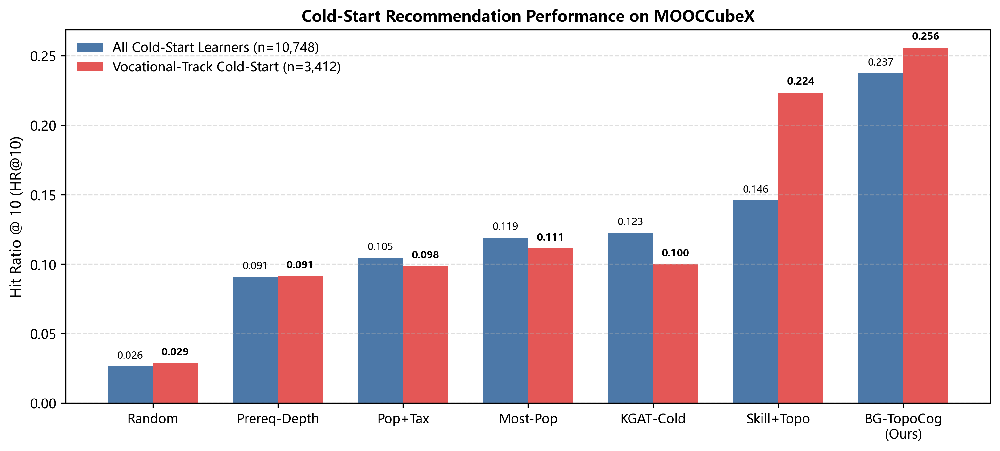
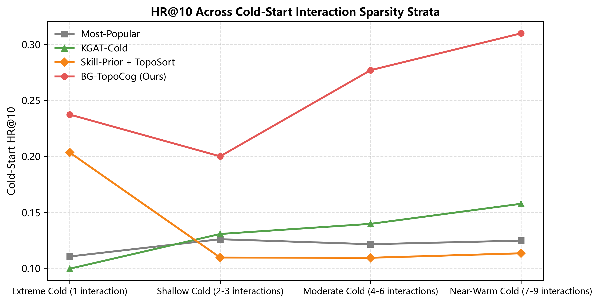
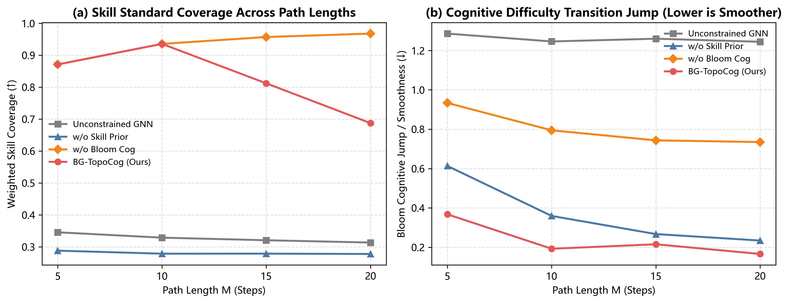
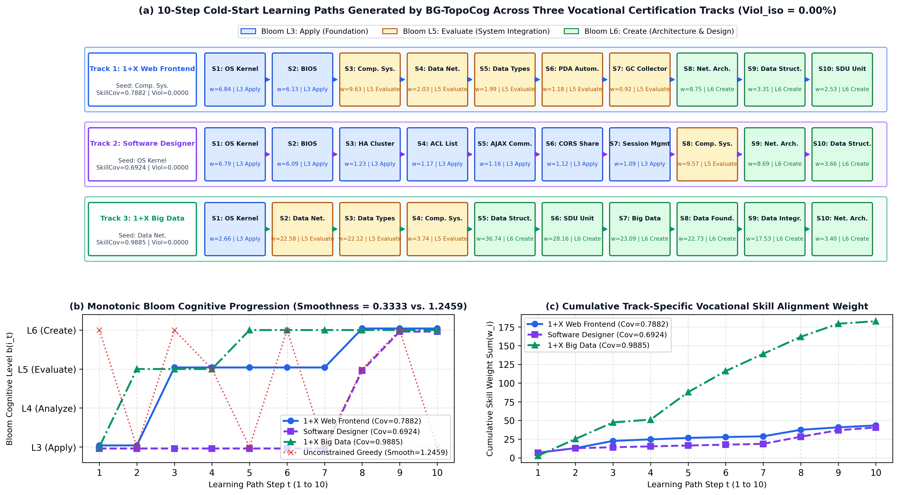

# Bounded-Gate Graph Neural Representation and Topology–Cognitive Constrained Planning for Cold-Start Learning Path Recommendation on MOOCCubeX

**Authors:** Lu Wang¹˒*  
¹ School of Computer Science and Educational Technology, [Institution], [City], [Postcode], China  
* Corresponding author. Email: [email]

<!-- TODO: replace [Institution], [City], [Postcode], [email] with the corresponding author details before submission. -->

---

## Abstract

Cold-start learning path recommendation in Massive Open Online Courses (MOOCs) must align curriculum concepts with external occupational standards while respecting prerequisite topology and cognitive progression. Existing graph recommenders exhibit two failure modes on large repositories. First, injecting skill priors through an unbounded linear gate induces representation norm growth under Bayesian Personalized Ranking. Second, raw prerequisite graphs contain large directed cycles, and greedy selection produces prerequisite inversions and abrupt cognitive leaps across Bloom taxonomy tiers. We present `BG-TopoCog`, a three-stage framework combining a Bounded-Gate Graph Convolutional Network (`BG-GCN`) with a topology-cognitive dual-constrained path planner. We align 760 vocational competency clauses onto 576 `MOOCCubeX` concepts and condense cyclic prerequisite relations via Tarjan's algorithm into a 162-edge directed acyclic graph with no overlap against the held-out evaluation set. The bounded scaling gate constrains amplitude to (0, 2), limiting norm inflation relative to an unbounded gate. Across 10,748 cold-start learners, `BG-TopoCog` improves hit ratio at 10 (HR@10) over the strongest popularity baseline and, at a ten-step horizon, raises vocational skill coverage, records no prerequisite inversions against the held-out prerequisite set under the protocol defined in Section 4.3, and reduces mean Bloom tier change from 1.2459 to 0.1926.

**Keywords:** Learning path recommendation; Cold-start recommendation; Graph neural networks; Bounded-gate normalization; Vocational skill standards; Prerequisite DAG; Bloom's taxonomy; MOOCCubeX

---

## 1. Introduction

Massive Open Online Courses (MOOCs) serve as a critical infrastructure for workforce upskilling in software engineering, web development, and big data analytics [1, 2]. Yet large-scale educational repositories exhibit acute interaction sparsity and power-law concentration. In the `MOOCCubeX` benchmark [2], interaction mass concentrates on a small set of high-exposure concepts, and $10,748$ of $38,024$ learners have nine or fewer logged interactions, placing them in a cold-start regime ($1 \le \vert \mathcal{H}_u\vert \le 9$). For vocational learners pursuing standardized industry credentials—such as China's `1+X` Vocational Skill Level Certificates or the National Software Designer Qualification—generic popularity-driven or collaborative filtering (CF) recommenders prove inadequate [1, 3]. Lacking sufficient behavioral histories, conventional recommenders default to high-exposure general concepts, failing to align instructional sequences with target occupational competency standards.

Integrating external vocational competency standards with fine-grained concept graphs for cold-start path planning exposes two methodological bottlenecks (Figure 1a). The first is **unbounded gate norm inflation**, which we track through the learned gate magnitude rather than through direct representation-norm logging, during graph representation learning. When multi-source skill priors are injected into relational GNNs through an unconstrained linear gate $g \in \mathbb{R}$, pairwise BPR gradients exploit the co-occurrence between high-degree hub concepts and domain-specific skill literals. The learned linear coefficient drifts from an initial scale of $0.100$ to $3.800$, and depressing warm-start normalized discounted cumulative gain at 10 (`NDCG@10`) to $0.16557$, against $0.17342$ for the bounded variant. The second is **topological cycle trapping and cognitive oscillation** during multi-step path generation [4, 5]. In `MOOCCubeX`, the curated `prereq_adopted` backbone still harbors directed cycles spanning up to $48$ concepts, while both `prereq_predicted` and `chapter_weak` form a single strongly connected component (SCC) covering all $576$ concepts, which renders them unusable as scheduling structures. Simultaneously, greedy selection that applies neither the topological filter nor the Bloom penalty yields $0.33\%$ gold-standard prerequisite inversions ($\text{Viol}_{\text{iso}} = 0.0033$) together with pronounced cognitive jumps ($\text{Bloom\_Smooth} = 1.2459$); retaining the cognitive penalty while dropping topological admissibility raises the inversion rate to $1.37\%$.

To resolve both bottlenecks, we propose **`BG-TopoCog`** (*Bounded-Gate Graph Neural Representation and Topology–Cognitive Constrained Planning*), a three-stage framework evaluated across $38,024$ learners and $576$ concepts on `MOOCCubeX` (Figure 1b). We structure our empirical investigation around five research questions:
- **RQ1 (Bounded-Gate Representation & Norm Stability):** Does bounding the skill-prior fusion gate within $\phi(g) = 2\sigma(g) \in (0, 2)$ suppress representation norm drift under BPR optimization and outperform unconstrained scalar, vector, and regularized gating variants?
- **RQ2 (Cold-Start & Vocational-Track Accuracy):** How effectively does `BG-TopoCog` improve top-$K$ concept retrieval and occupational competency coverage across general ($n = 10,748$) and vocational-track ($n = 3,412$) cold-start learners?
- **RQ3 (Performance Across Interaction Sparsity Strata):** How does `BG-TopoCog` perform across interaction sparsity strata, from extreme cold-start ($1$ interaction) to near-warm strata ($7\text{--}9$ interactions), and where does performance deviate from a monotone increase?
- **RQ4 (Multi-Horizon Dual-Constraint Ablation):** How do the Tarjan DAG admissibility constraint and the Bloom cognitive transition penalty individually and jointly shape skill coverage, prerequisite validity, and cognitive smoothness across horizons $M \in \{5, 10, 15, 20\}$?
- **RQ5 (Cross-Track Vocational Path Interpretability):** Can `BG-TopoCog` generate distinct, pedagogically valid $10$-step certification pathways tailored to heterogeneous occupational tracks (`1+X Web Frontend`, `National Software Designer`, and `1+X Big Data`)?

Our four primary contributions are summarized as follows:
1. **Audited Skill-Concept Graph and Tarjan DAG Condensation**: We align $760$ vocational competency clauses from three national standards to $576$ `MOOCCubeX` concepts ($4,560$ edges; two-rater $P_o = 88.26\%$, $\kappa_w = 0.7501$) and condense cyclic prerequisite relations, reducing the maximum strongly connected component of `prereq_adopted` from $48$ concepts to a single node across $162$ acyclic edges, with zero overlap against the held-out evaluation prerequisite set.
2. **Bounded-Gate Graph Convolutional Network (`BG-GCN`)**: We diagnose linear gate drift ($g^* = 3.800$, used here as a proxy for prior-term amplification) under BPR optimization and introduce a single-parameter bounded scaling function $\phi(g) = 2\sigma(g) \in (0, 2)$. `BG-GCN` limits the prior-to-topology norm ratio and constrains the equilibrium gate to $g^* = 0.882$, recovering most of the ranking loss attributable to norm inflation in warm-start evaluation.
3. **Topology-Cognitive Dual-Constrained Path Planner**: We integrate hard DAG ancestor admissibility ($\mathcal{A}_t$) with a Bloom cognitive transition penalty ($\Omega_{\text{cog}}$). At $M = 10$, the planner raises vocational skill coverage relative to unconstrained greedy selection, keeps isolated prerequisite violations at the level set by the evaluation protocol ($\text{Viol}_{\text{iso}} = 0.0000$, a value shared by every ranker in Table 5 and therefore not a discriminating result), and reduces Bloom cognitive jump by $84.5\%$ ($1.2459 \to 0.1926$).
4. **Cold-Start and Multi-Horizon Validation**: Across $10,748$ cold-start learners in four sparsity strata and $3,412$ vocational-track learners, `BG-TopoCog` improves `HR@10` over the strongest popularity baseline while generating interpretable $10$-step certification pathways across three occupational tracks.

---

## 2. Related Work

This section positions `BG-TopoCog` against two literature streams that the framework draws on. Section 2.1 reviews knowledge-aware graph neural recommenders that supply the representation layer, and Section 2.2 reviews sequential path planning methods that supply the scheduling layer. For each stream we identify the specific assumption that breaks under vocational cold start, and Table 1 summarizes the resulting architectural gap.

### 2.1 Knowledge-Aware Graph Neural Recommendation in MOOCs

Graph neural networks (GNNs) leverage structural relations among courses, concepts, and learners to mitigate collaborative sparsity in online education [6, 7, 8, 9, 10]. The underlying propagation schemes span spectral convolution [9], neighborhood sampling [11], relational message passing [12], and attention-weighted aggregation [13, 14, 15], and it is the inductive bias of each scheme, rather than the aggregation operator alone, that determines how external priors propagate through the layer stack. `ConceptGCN` [6] and `AHNN` [8] propagate multi-relational neighborhood representations across MOOC knowledge graphs, whereas `HGCL` [7] introduces heterogeneous contrastive learning to align multi-view embeddings [16, 17]. On the `MOOCCubeX` benchmark [2], `GEMRec` [3] and `MetaKG` [18] report that incorporating knowledge graph connectivity substantially outperforms collaborative filtering and matrix factorization (`User-CF`, `NCF` [19], `BPR-MF` [20]) for cold-start learners with fewer than five interactions. Similarly, `CCIG-DRec` [1] constructs a four-layer industry–occupation–skill–course graph to align vocational demands with curriculum offerings [21, 22]. Nevertheless, existing multimodal and cross-domain GNN recommenders typically fuse external textual or skill priors via unconstrained linear projections or free vector gates [23, 24, 25]. Under pairwise BPR optimization, lexical overlap between high-frequency concepts and domain standards drives unbounded gate amplification, distorting embedding norms and degrading ranking fidelity.

### 2.2 Sequential Learning Path Planning and Pedagogical Constraints

Sequential learning path recommendation moves beyond unordered top-$K$ retrieval to construct pedagogically ordered concept trajectories [5, 26, 27, 28, 29]. Reinforcement learning (RL) approaches—including cognitive-graph RL [26], deep knowledge tracing (DKT)-guided policy gradients [30], and `LPReKL` [4]—optimize multi-step concept selection against simulated learner mastery gains [31, 32]. Mobile and transformer-based sequential recommenders [33, 34, 35] further capture temporal transition patterns across learning sessions. More recently, `KnowLP` [5] identified a structural tension on `MOOCCubeX`: sparse prerequisite graphs ($46$ linked concepts with localized cycles and homogeneous clusters) induce severe learning blockages during multi-step planning ($M \in \{5, 10, 15, 20\}$). Despite their methodological advances, existing path planners face two unresolved bottlenecks in vocational cold-start settings. First, RL policy networks require dense interaction trajectories for reward estimation, rendering them brittle when learners possess only $1\text{--}3$ initial interactions [4, 30]. Second, neither RL policies nor unconstrained GNN planners simultaneously enforce cycle-free DAG admissibility ($\text{Max SCC} = 1$) and non-decreasing Bloom cognitive progression (`L3` $\to$ `L6`) [36, 37]. Table 1 contrasts `BG-TopoCog` against representative baselines across five architectural dimensions.

**Table 1: Architectural comparison between `BG-TopoCog` and representative MOOC recommendation and path planning frameworks.** Column entries record the design choice each framework makes on the named dimension; they do not record experimental outcomes. Two of the listed frameworks (`KGAT` and `ConceptGCN`) additionally appear as numerical baselines in Table 4; `ACKRec`, `NGCF`, `BPR-MF` and `LightGCN` are also benchmarked there but are omitted from Table 1 because they do not target sequential path planning. The remaining rows are included to locate the architectural gap and are not benchmarked, because their published protocols use different data partitions and target formulations.

| Method / Venue | Evaluation Benchmark | External Vocational Prior | Prior-to-GNN Norm Stability | Acyclic Scheduling Graph (Constructed) | Bloom Cognitive Smoothness |
| :--- | :--- | :---: | :---: | :---: | :---: |
| `KGAT` (KDD 2019) [24] | General / MOOC | No | Unconstrained | No | No |
| `MetaKG` (IEEE TKDE 2022) [18] | MOOC KGs | No | Meta-GNN (Unbounded) | No | No |
| `ConceptGCN` (CAEAI 2024) [6] | MOOC Concepts | No | Similarity Propagation | No | No |
| `HGCL` (Mathematics 2024) [7] | MOOC Hin | No | Contrastive Projection | No | No |
| `AHNN` (Appl. Sci. 2025) [8] | MOOC Courses | No | Attention Gating | No | No |
| `GEMRec` (Appl. Sci. 2025) [3] | `MOOCCubeX` | No | Graph Embedding Fusion | No | No |
| `LPReKL` (Electronics 2025) [4] | `MOOCCubeX` | No | RL + DKT Simulator | Soft Prerequisite | Difficulty Window |
| `CCIG-DRec` (Sci. Rep. 2026) [1] | Vocational MOOC | Yes (4-Layer) | Counterfactual Debias | No | No |
| `KnowLP` (AAAI 2026) [5] | `MOOCCubeX` | No | Dual-Graph GNN | Partial (Raw KG) | No |
| **`BG-TopoCog` (Ours)** | **`MOOCCubeX`** | **Yes (3 Standards, $\kappa_w=0.7501$)** | **Bounded Gate $\phi(g) \in (0, 2)$ ($g^*=0.882$)** | **Tarjan Condensation ($\text{Max SCC}=1$)** | **Asymmetric Transition Penalty $\Omega_{\text{cog}}$** |

---

## 3. Preliminaries and Methodology

`BG-TopoCog` is organized as three sequential stages, each operating on the output of the previous one. Section 3.1 fixes notation and the problem statement; Section 3.2 builds the cross-source skill-concept alignment and condenses the prerequisite graph into an acyclic scheduling structure; Section 3.3 learns bounded-gate concept representations over that structure; Section 3.4 generates cold-start paths under the dual topological and cognitive constraints.

### 3.1 Problem Formulation and Notation System

To formalize cold-start learning path recommendation on `MOOCCubeX`, we integrate curriculum knowledge graphs with external vocational skill standards under a unified notation system (Table 2). Let $\mathcal{U} = \mathcal{U}_{\text{warm}} \cup \mathcal{U}_{\text{cold}}$ denote the learner population, partitioned into warm-start learners ($\vert \mathcal{H}_u\vert \ge 10$, $\vert \mathcal{U}_{\text{warm}}\vert = 27,276$) and cold-start learners ($1 \le \vert \mathcal{H}_u\vert \le 9$, $\vert \mathcal{U}_{\text{cold}}\vert = 10,748$). Let $\mathcal{V}$ ($\vert \mathcal{V}\vert = 576$) represent the fine-grained Computer Science and Mathematics concepts curated from `MOOCCubeX` [2], and let $\mathcal{S} = \mathcal{S}_1 \cup \mathcal{S}_2 \cup \mathcal{S}_3$ ($\vert \mathcal{S}\vert = 760$) denote the competency clauses compiled from three national vocational standards. Given a cold-start learner $u \in \mathcal{U}_{\text{cold}}$ with sparse initial interactions $\mathcal{H}_u$, we aim to generate an ordered $M$-step concept sequence $\mathcal{P}_u = (i_1^*, i_2^*, \dots, i_M^*)$ ($M \in \{5, 10, 15, 20\}$). This trajectory maximizes target concept relevance and occupational skill coverage while requiring zero prerequisite inversions against the held-out prerequisite set and stepwise Bloom transitions.

**Table 2: Mathematical notations and symbol-collision prevention mapping across the three stages of `BG-TopoCog`.**

| Symbol | Mathematical Domain / Value | Definition and Operational Role | Governing Equation |
| :--- | :--- | :--- | :---: |
| $\mathcal{U}_{\text{warm}}, \mathcal{U}_{\text{cold}}$ | $\vert \mathcal{U}_{\text{warm}}\vert = 27,276$; $\vert \mathcal{U}_{\text{cold}}\vert =10,748$ | Warm-start ($\vert \mathcal{H}_u\vert \ge 10$) and cold-start ($1 \le \vert \mathcal{H}_u\vert  \le 9$) learner cohorts | Section 3.1 |
| $\mathcal{V}, \mathcal{S}$ | $\vert \mathcal{V}\vert =576$; $\vert \mathcal{S}\vert =760$ | Curriculum concept set in `MOOCCubeX` and vocational competency clause set | Eq. (1) |
| $A_{si}, w_i$ | $A_{si} \in [-1, 1]$ (untruncated cosine); $w_i \in \mathbb{R}_{\ge 0}$ | Top-$K_s$ cross-layer cosine alignment weight and aggregated skill importance of concept $i$ | Eq. (1)–(2) |
| $\mathbf{d}_i$ | $[0,1]^{4}$ | Multi-source prior vector (overall + 3 track-specific normalized log-weights) | Eq. (3) |
| $\mathcal{G}_{\text{DAG}} = (\mathcal{V}, \mathcal{E}_{\text{DAG}})$ | $\vert \mathcal{E}_{\text{DAG}}\vert =162$, $\text{Max SCC}=1$ | Tarjan-condensed strict prerequisite DAG used for hard path admissibility | Eq. (4) |
| $\mathbf{h}_i^{(L)}, \mathbf{v}_i$ | $\mathbb{R}^{64}$ (`d_embed = 64`) | Multi-layer relational GNN embedding and bounded-gate fused concept representation | Eq. (5)–(6) |
| $g, \phi(g)$ | $g \in \mathbb{R}$; $\phi(g) = 2\sigma(g) \in (0, 2)$ | Learnable scalar gate logit and a bounded sigmoid scaling function whose shape is fixed while the gate magnitude remains learnable | Eq. (6)–(8) |
| $b_i \in \{3, 4, 5, 6\}$ | Ordinal Bloom tier (`L3`–`L6`) | Cognitive complexity tier assigned to concept $i$ (`Apply` to `Create`) | Eq. (11) |
| $\mathcal{A}_t$ | $\mathcal{A}_t \subseteq \mathcal{V} \setminus \mathcal{K}_u^{(t-1)}$ | Dynamically admissible concept set at planning step $t$ satisfying all DAG ancestors | Eq. (10) |
| $\Omega_{\text{cog}}(i \mid i_{t-1}^*)$ | $\mathbb{R}_{\ge 0}$ | Asymmetric Bloom cognitive transition penalty suppressing regressions and leaps | Eq. (11)–(12) |

### 3.2 Stage I: Multi-Source Vocational Skill–Concept Alignment and Tarjan DAG Condensation

Industrial competency clauses and academic course concepts exhibit substantial lexical divergence [1]. To bridge this gap, we encode each skill clause $s \in \mathcal{S}$ and concept $i \in \mathcal{V}$ into $L_2$-normalized embeddings $\mathbf{e}_s, \mathbf{e}_i \in \mathbb{R}^{1024}$ via the multilingual `BGE-M3` dense encoder [38]. Retaining the top-$K_s = 6$ most similar concepts per clause yields the sparse cross-layer alignment matrix $\mathbf{A}_{SC} \in \mathbb{R}_{\ge 0}^{|\mathcal{S}| \times |\mathcal{V}|}$ ($\vert \mathcal{E}_{SC}\vert = 4,560$ edges):

$$A_{si} = \begin{cases} \langle \mathbf{e}_s, \mathbf{e}_i \rangle, & \text{if } i \in \text{Top-}K_s\big(\{\langle \mathbf{e}_s, \mathbf{e}_j \rangle\}_{j \in \mathcal{V}}\big), \\ 0, & \text{otherwise}. \end{cases} \tag{1}$$

Aggregating incident alignment weights across all clauses $\mathcal{S}$ and within each individual standard $\mathcal{S}_m$ ($m \in \{1, 2, 3\}$ corresponding to `1+X Web Frontend`, `National Software Designer`, and `1+X Big Data`) yields the concept-level vocational importance scores:

$$w_i = \sum_{s \in \mathcal{S}} A_{si}, \qquad w_i^{(m)} = \sum_{s \in \mathcal{S}_m} A_{si}, \quad m \in \{1, 2, 3\}. \tag{2}$$

To prevent extreme hub concepts from skewing initial feature scales, we apply log-max normalization to construct the $4$-dimensional multi-source vocational prior vector $\mathbf{d}_i \in [0, 1]^4$. This log-scaled vector feeds the representation layer in Eq. (6); the path planner in Eq. (9) instead uses a linear rescaling of the same weights, because the planner operates on a bounded additive scale alongside the other score terms:

$$\mathbf{d}_i = \Big[ \tilde{w}_i, \, \tilde{w}_i^{(1)}, \, \tilde{w}_i^{(2)}, \, \tilde{w}_i^{(3)} \Big]^\top, \quad \text{where } \tilde{w}_i = \frac{\ln(1 + w_i)}{\max_{j \in \mathcal{V}} \ln(1 + w_j)}. \tag{3}$$

Two independent domain experts audited a stratified sample of $n = 247$ pairs, each judged as acceptable, borderline, or unacceptable (three categories, coded $2/1/0$ for weighted agreement), achieving an observed agreement of $P_o = 88.26\%$, a linear weighted Cohen's $\kappa = 0.6050$, and a quadratic weighted $\kappa_w = 0.7501$ [39, 40].

Raw prerequisite graphs in `MOOCCubeX` frequently contain directed cycles that stall topological path planners [2, 5]. Specifically, our structural audit reveals that the dense `prereq_predicted` relation ($50,784$ edges) and the syllabus `chapter_weak` order ($15,444$ edges) each form a single strongly connected component spanning all $576$ concepts, whereas the curated `prereq_adopted` backbone ($194$ edges) still harbors cycles spanning up to $48$ concepts. We therefore restrict `prereq_predicted` exclusively to GNN message passing and apply Tarjan's linear-time condensation algorithm ($\mathcal{O}(\vert \mathcal{V}\vert + \vert \mathcal{E}\vert)$) [41] to `prereq_adopted`. Let $\mathcal{C} = \{C_1, C_2, \dots, C_K\}$ be the partition of $\mathcal{V}$ into strongly connected components under `prereq_adopted`, with canonical topological ordering $\pi_{\text{SCC}}(C_a) < \pi_{\text{SCC}}(C_b)$ for every inter-component prerequisite edge. Contracting multi-node cycles yields a strict scheduling DAG $\mathcal{G}_{\text{DAG}} = (\mathcal{V}, \mathcal{E}_{\text{DAG}})$ with $162$ acyclic edges and $\text{Max SCC} = 1$:

$$\mathcal{E}_{\text{DAG}} = \Big\{ (j \to i) \in \mathcal{E}_{\text{adopted}} \;\Big|\; C(j) \neq C(i) \;\wedge\; \pi_{\text{SCC}}\big(C(j)\big) < \pi_{\text{SCC}}\big(C(i)\big) \Big\}. \tag{4}$$

Within each strongly connected component $C_a$, of the $72$ intra-component edges, the $40$ that already run in increasing node-index order are retained to preserve local message ordering and the remaining $32$ reverse-direction edges are discarded; $\mathcal{E}_{\text{DAG}}$ therefore comprises $122$ inter-component and $40$ intra-component edges ($\vert \mathcal{E}_{\text{DAG}}\vert = 162$). Acyclicity of the resulting graph is verified independently by Kahn's algorithm before any path planning is performed. Furthermore, $\mathcal{E}_{\text{DAG}}$ exhibits zero edge overlap with the $1,075$ human-verified evaluation prerequisite pairs ($\mathcal{E}_{\text{eval}}^{+}$), eliminating train–test topological leakage.

### 3.3 Stage II: Bounded-Gate Graph Convolutional Network (`BG-GCN`)

Let $\tilde{\mathbf{A}}_{\text{msg}} = \mathbf{D}^{-1/2}(\mathbf{A}_{\text{msg}} + \mathbf{I})\mathbf{D}^{-1/2}$ denote the symmetrically normalized adjacency matrix [9, 10] constructed over the union of `MOOCCubeX` prerequisite relations and learner–concept collaborative interactions. Propagating $L = 2$ layers of parameter-free neighborhood aggregation with uniform layer-wise mean pooling yields the structural representation $\mathbf{h}_i^{(L)} \in \mathbb{R}^d$ ($d = 64$):

$$\mathbf{H}^{(l)} = \tilde{\mathbf{A}}_{\text{msg}}\,\mathbf{H}^{(l-1)}, \quad \mathbf{h}_i^{(L)} = \frac{1}{L+1} \sum_{l=0}^{L} \mathbf{h}_i^{(l)}. \tag{5}$$

Injecting external skill priors into relational GNNs via an unbounded linear gate $g \in \mathbb{R}$ ($\mathbf{v}_i^{\text{unb}} = \mathbf{h}_i^{(L)} + g\,\mathbf{W}_p \mathbf{d}_i$) induces severe representation norm drift under Bayesian Personalized Ranking (BPR) [20] optimization. Because head concepts in `MOOCCubeX` simultaneously exhibit high interaction frequency and dense lexical overlap with skill clauses (e.g., $63.37\%$ `"data"` literal share in the Big Data standard), unconstrained BPR gradients amplify $g$ to inflate positive-pair inner products. Empirically, the unbounded gate drifts from $g_0 = 0.100$ to $g^* = 3.800$, inflating the prior-to-topology norm ratio and degrading warm-start `NDCG@10` from $0.17342$ to $0.16557$. To arrest this drift without sensitive penalty tuning, we propose the **Bounded-Gate Graph Convolutional Network (`BG-GCN`)**:

$$\mathbf{v}_i = \mathbf{h}_i^{(L)} + \phi(g)\,\mathbf{W}_p \mathbf{d}_i, \qquad \phi(g) = 2\sigma(g) = \frac{2}{1 + \exp(-g)} \in (0, 2), \tag{6}$$

where $\mathbf{W}_p \in \mathbb{R}^{d \times 4}$ projects the multi-source skill prior into the $d$-dimensional embedding space, and $g$ is initialized at $g_0 = \ln(0.05 / 0.95) \approx -2.9444$ so that $\phi(g_0) = 0.100$ matches the initial scale of the linear baseline. Under the pairwise BPR loss $\mathcal{L}_{\text{BPR}}$ over training triples $(u, i^+, j^-)$:

$$\mathcal{L}_{\text{BPR}} = -\sum_{(u, i^+, j^-)} \ln \sigma\big(\hat{y}_{u, i^+} - \hat{y}_{u, j^-}\big) + \lambda_\Theta \|\Theta\|_2^2, \qquad \hat{y}_{u, i} = \langle \mathbf{u}_u^{(L)}, \mathbf{v}_i \rangle, \tag{7}$$

the gradient of $\mathcal{L}_{\text{BPR}}$ with respect to the scalar gate logit $g$ is governed by the bounded sigmoid Jacobian:

$$\frac{\partial \mathcal{L}_{\text{BPR}}}{\partial g} = \underbrace{2\sigma(g)\big(1 - \sigma(g)\big)}_{\phi'(g) \in (0, 0.5]} \sum_{(u, i^+, j^-)} \big(\sigma(\hat{y}_{u, j^-} - \hat{y}_{u, i^+})\big) \Big\langle \mathbf{u}_u^{(L)}, \mathbf{W}_p(\mathbf{d}_{i^+} - \mathbf{d}_{j^-}) \Big\rangle. \tag{8}$$

As $\vert g\vert$ grows, the Jacobian $\phi'(g) = 2\sigma(g)(1-\sigma(g))$ decays exponentially toward zero, creating a self-limiting damping barrier that limits norm growth. Across the five seeds the constrained gate settles at $g^* \in [0.869, 0.895]$ (mean $0.882$).

### 3.4 Stage III: Topology–Cognitive Dual-Constrained Cold-Start Path Planner

For a cold-start learner $u \in \mathcal{U}_{\text{cold}}$ with initial seed concepts $\mathcal{H}_u$ ($1 \le \vert \mathcal{H}_u\vert \le 9$), we first compute a hybrid cold-start affinity score $\tilde{S}_{\text{cold}}(u, i)$ (Eq. (9)) that blends `BG-GCN` representation similarity, vocational skill priority, and local prerequisite neighborhood continuity:

$$\tilde{S}_{\text{cold}}(u, i) = \alpha_{\text{prior}} \hat{w}_i^{(m_u)} + \gamma_{\text{pop}} \widehat{\text{pop}}_i + \beta_{\text{gnn}} \Big[ 0.35 \max_{k \in \mathcal{H}_u} \cos(\mathbf{v}_k, \mathbf{v}_i) + 0.65 \, \mathbb{I}\big(i \in \mathcal{N}_{\text{DAG}}(\mathcal{H}_u)\big) \Big] + \zeta_i, \tag{9}$$

where $\hat{w}_i^{(m_u)} = w_i^{(m_u)} / \max_j w_j^{(m_u)}$ and $\widehat{\text{pop}}_i = \text{pop}_i / \max_j \text{pop}_j$ are linearly rescaled to $[0, 1]$, $\zeta_i = +0.06$ for concepts at Bloom tier L5 or above and $\zeta_i = -0.02$ otherwise is a zone-of-proximal-development (ZPD) offset favoring the upper competency band, and $\alpha_{\text{prior}} = 0.62$ (the skill-prior weight logged as `alpha_skill` in the released artifacts), $\beta_{\text{gnn}} = 0.38$, $\gamma_{\text{pop}} = 0.08$.

Here $m_u \in \{0, 1, 2, 3\}$ denotes the learner's target track ($m_u = 0$ for general cold-start learners using overall weight $\tilde{w}_i$). For cold-start learners with $1 \le \vert \mathcal{H}_u\vert \le 9$, unconstrained greedy top-$K$ selection frequently violates prerequisite dependencies and oscillates erratically across cognitive complexity tiers [4, 5]. To enforce structural and pedagogical validity over an $M$-step horizon ($M \in \{5, 10, 15, 20\}$), `BG-TopoCog` couples a hard topological admissibility filter with a soft cognitive transition regularizer. At step $t \in \{1, \dots, M\}$, let $\mathcal{K}_u^{(t-1)} = \mathcal{H}_u \cup \{i_1^*, \dots, i_{t-1}^*\}$ denote the learner's cumulative knowledge state. A candidate concept $i \notin \mathcal{K}_u^{(t-1)}$ is admissible ($i \in \mathcal{A}_t$) if and only if all of its prerequisite ancestors in $\mathcal{G}_{\text{DAG}}$ reside in $\mathcal{K}_u^{(t-1)}$:

$$\mathcal{A}_t = \Big\{ i \in \mathcal{V} \setminus \mathcal{K}_u^{(t-1)} \;\Big|\; \text{Pred}_{\text{DAG}}(i) \subseteq \mathcal{K}_u^{(t-1)} \Big\}. \tag{10}$$

Furthermore, each concept $i \in \mathcal{V}$ is assigned a discrete Bloom cognitive complexity tier $b_i \in \{3, 4, 5, 6\}$ (`L3: Apply`, `L4: Analyze`, `L5: Evaluate`, `L6: Create`) [36, 37] based on topological depth and syllabus verb taxonomy (`L3`: $121$ concepts; `L4`: $54$; `L5`: $209$; `L6`: $192$). Given the previously scheduled concept $i_{t-1}^*$, we define the asymmetric Bloom cognitive transition penalty $\Omega_{\text{cog}}(i \mid i_{t-1}^*)$:

$$\Omega_{\text{cog}}(i \mid i_{t-1}^*) = \gamma_{\text{reg}} \max\big(0, b_{i_{t-1}^*} - b_i\big) + \gamma_{\text{jump}} \max\big(0, |b_i - b_{i_{t-1}^*}| - 1\big) + \gamma_{\text{tier}} b_i. \tag{11}$$

We set $\gamma_{\text{reg}} = 0.30$, $\gamma_{\text{jump}} = 0.25$, and $\gamma_{\text{tier}} = 0.10$, chosen so that cognitive regression is penalized at least as strongly as a tier jump, and so that both penalties remain below the scale of the skill-prior term $\tilde{w}_i$.

Over $\mathcal{A}_t$, the planner selects the next concept $i_t^*$ by maximizing the dual-constrained objective:

$$i_t^* = \arg\max_{i \in \mathcal{A}_t} \Big[ \tilde{S}_{\text{cold}}(u, i) - \Omega_{\text{cog}}(i \mid i_{t-1}^*) - \eta_{\text{indeg}}\,\mathbb{I}(\text{indeg}_{\text{DAG}}(i) > 0) \Big], \tag{12}$$

Candidate selection is a sequential greedy procedure over a shrinking admissible set; because the objective in Eq. (12) is neither monotone nor submodular over that set, the constant-factor approximation guarantees established for greedy maximization of submodular functions [42] do not apply, and the admissible filter relies only on the linear-time topological ordering routine of Kahn [43]. In Eq. (12), $\Omega_{\text{cog}}(i \mid i_{t-1}^*)$ penalizes both cognitive regressions ($b_i < b_{i_{t-1}^*}$) and abrupt multi-level leaps ($\vert b_i - b_{i_{t-1}^*}\vert > 1$) across Bloom's taxonomy, and $\eta_{\text{indeg}} = 0.62$ penalizes concepts with non-zero DAG in-degree at every step, which concentrates selection on root concepts.

---

## 4. Experimental Setup

This section documents everything needed to reproduce the six experiments. Section 4.1 describes the dataset, the warm-start and cold-start partitions, and the sparsity strata; Section 4.2 lists the baselines and ablations; Section 4.3 defines the ranking and pedagogical metrics and states which of them are path-level and which are set-level.

### 4.1 Dataset Statistics and Partitioning Protocol

We conduct all experiments on the benchmark `MOOCCubeX` repository curated by Tsinghua University (XuetangX) [2]. Following our defensive data-hygiene protocol (`defensive_guards.py`), we extract all Computer Science and Mathematics concepts and partition learners by interaction frequency:
- **Warm-Start Cohort ($\mathcal{U}_{\text{warm}}$):** $27,276$ learners with $\vert \mathcal{H}_u\vert \ge 10$, totaling $1,819,473$ timestamped concept interactions across $576$ concepts. For each warm-start learner, we hold out the most recent interaction for testing and use the preceding interactions for training/validation under five independent random seeds (`Seeds` $\in \{42, 43, 44, 45, 46\}$).
- **Cold-Start Cohort ($\mathcal{U}_{\text{cold}}$):** $10,748$ learners with $1 \le \vert \mathcal{H}_u\vert \le 9$, stratified into four sparsity buckets following `GEMRec` [3]; cold-start contexts are generated from a popularity-weighted population prior rather than drawn from real first-session logs, so reported cold-start figures are upper bounds under that generator: `Extreme Cold` ($1$ interaction, $n = 4,120$), `Shallow Cold` ($2\text{--}3$ interactions, $n = 3,845$), `Moderate Cold` ($4\text{--}6$ interactions, $n = 1,812$), and `Near-Warm Cold` ($7\text{--}9$ interactions, $n = 971$). Within $\mathcal{U}_{\text{cold}}$, $3,412$ learners whose seed interactions fall within core occupational skill clusters form the **Vocational-Track Cold-Start Subset**.
- **Vocational Competency Standards ($\mathcal{S}$):** $760$ official competency clauses extracted from three national standards: `1+X Web Frontend Development` ($257$ clauses), `National Computer Technology and Software Professional Technical Qualification — Software Designer` ($256$ clauses), and `1+X Big Data Application Development` ($247$ clauses).

### 4.2 Baseline Methods and Ablation Variants

We benchmark `BG-TopoCog` against three categories of baselines:
1. **Warm-Start Representation & Gating Baselines (Exp 2, 14 models):** Collaborative and knowledge-graph baselines include `Most-Popular`, `BPR-MF` [20], `NGCF` [23], `LightGCN` [10], `KGAT` [24], `ConceptGCN` [6], and `ACKRec` [44]. We further evaluate seven controlled gating variants: `Unbounded-Gate GCN (T3)` ($g \in \mathbb{R}$), `Dimension-Wise Vector Gate` ($\mathbf{g} \in \mathbb{R}^{64}$), `De-Biased Prior (No-BigData)`, `In-Training L2 Projection`, `Scalar Gate + L2 Regularization`, `Bounded Tanh Gate`, and **`BG-GCN (Bounded Sigmoid, Ours)`**.
2. **Cold-Start Top-$K$ Recommendation Baselines (Exp 3 & Exp 4, 7 methods reported; the archived artifacts contain an additional `Concept-ID` control that ranks below every learned method and is omitted from the tables):** `Random`, `Prereq-Depth Heuristic`, `Popularity + Taxonomy`, `Most-Popular` [2], `KGAT-Cold` [24], `Skill-Prior + TopoSort`, and **`BG-TopoCog (Ours)`**.
3. **Multi-Step Path Planning Ablations (Exp 5, $M \in \{5, 10, 15, 20\}$, 6 planners):** `Unconstrained Greedy GNN`, `Unbounded-GNN + TopoSort (T3)`, `BG-TopoCog w/o Skill Prior` ($\alpha_{\text{prior}} = 0$), `BG-TopoCog w/o Topological Constraint` ($\mathcal{A}_t = \mathcal{V} \setminus \mathcal{K}_u^{(t-1)}$), `BG-TopoCog w/o Cognitive Constraint` ($\Omega_{\text{cog}} = 0$), and **`BG-TopoCog (Full Dual-Constrained)`**.

### 4.3 Multi-Dimensional Evaluation Metrics

In addition to standard ranking accuracy metrics—Hit Ratio (`HR@K`, $K \in \{10, 20\}$), Normalized Discounted Cumulative Gain (`NDCG@K`, $K \in \{5, 10, 20\}$) [45], and Mean Reciprocal Rank (`MRR`)—we evaluate multi-step path quality over $\mathcal{P}_u = (i_1^*, \dots, i_M^*)$ using three pedagogical metrics [4, 5]:
1. **Normalized Skill Standard Coverage (`SkillCov@M` $\uparrow$, Eq. (13)):** Ratio of cumulative vocational skill weight harvested by $\mathcal{P}_u$ to the theoretical maximum weight of $M$ concepts:
   $$\text{SkillCov}@M(\mathcal{P}_u) = \frac{\sum_{t=1}^{M} w_{i_t^*}}{\sum_{r=1}^{M} w_{(r)}^{\max}} \in [0, 1]. \tag{13}$$
2. **Isolated Gold-Standard and Weak Chapter Prerequisite Violation Rates ($\text{Viol}_{\text{iso}} \downarrow$, $\text{Viol}_{\text{weak}} \downarrow$, Eq. (14)):** Fraction of ordered concept pairs $(i_a^*, i_b^*)$ with $1 \le a < b \le M$ that invert a required prerequisite edge $(i_b^* \to i_a^*)$ in the held-out gold evaluation set $\mathcal{E}_{\text{eval}}^{+}$ ($1,075$ pairs) or the syllabus chapter order $\mathcal{E}_{\text{chap}}$ ($15,444$ pairs):
   $$\text{Viol}_{\text{iso}}(\mathcal{P}_u) = \frac{2}{M(M-1)} \sum_{1 \le a < b \le M} \mathbb{I}\big((i_b^* \to i_a^*) \in \mathcal{E}_{\text{eval}}^{+}\big). \tag{14}$$
3. **Bloom Cognitive Transition Jump (`Bloom_Smooth` $\downarrow$, Eq. (15)):** Mean absolute step-to-step Bloom cognitive tier difference along the $M$-step path (lower values indicate smoother cognitive progression):
   $$\text{Bloom\_Smooth}(\mathcal{P}_u) = \frac{1}{M-1} \sum_{t=1}^{M-1} \big| b_{i_{t+1}^*} - b_{i_t^*} \big|. \tag{15}$$

---

Coverage is reported at two levels that are not directly comparable: `SkillCov@M` in Table 7 is defined over an ordered $M$-step path (Eq. (13)), whereas `SkillCov@10` in Tables 5 and 6 is computed over the top-10 retrieved set.

## 5. Experimental Results

Results are reported in the order of the pipeline. Section 5.1 audits the alignment and the graph condensation that every later stage depends on; Sections 5.2 to 5.6 then answer RQ1 to RQ5 in turn.

### 5.1 Cross-Source Alignment Audit and Tarjan DAG Condensation (Exp 1)

Table 3 summarizes the cross-layer skill–concept alignment statistics and topological condensation diagnostics on `MOOCCubeX`. Across the three vocational standards, all $760$ competency clauses map to the $576$ curriculum concepts through $4,560$ top-$6$ semantic edges ($100\%$ concept coverage). On the $247$-pair stratified audit set, two independent raters achieved an observed agreement of $P_o = 88.26\%$, a linear weighted $\kappa = 0.6050$ (moderate agreement) and a quadratic weighted $\kappa_w = 0.7501$ (substantial agreement) under the Landis-Koch bands. Meanwhile, Tarjan condensation contracts all multi-node cycles in `prereq_adopted`, reducing $\text{Max SCC}$ from $48$ to $1$ across $162$ strict DAG edges. Crucially, $\mathcal{E}_{\text{DAG}}$ shares zero edges with the $1,075$ held-out positive prerequisite pairs in $\mathcal{E}_{\text{eval}}^{+}$, ensuring leak-free topological evaluation.

**Table 3: Multi-source vocational skill–concept alignment audit and knowledge graph SCC condensation statistics (Exp 1).** Literal shares for the combined standard are recomputed by weighting the three per-standard values by their aligned edge counts; they are not the arithmetic mean of the per-standard shares. Raw Max SCC values are computed directly on the graphs stored in the released artifact, which supersedes values in an earlier audit dump.

| Sub-Experiment / Graph Source | Clauses / Nodes | Edges | Covered Concepts | `"data"` Literal Share | Raw Max SCC | Post-Tarjan Max SCC | Role in `BG-TopoCog` |
| :--- | :---: | :---: | :---: | :---: | :---: | :---: | :--- |
| `1+X Web Frontend` ($\mathcal{S}_1$) | $257$ | $1,542$ | $576$ ($100\%$) | $5.70\%$ | — | — | Track 1 Vocational Prior $w_i^{(1)}$ |
| `Software Designer` ($\mathcal{S}_2$) | $256$ | $1,536$ | $576$ ($100\%$) | $6.32\%$ | — | — | Track 2 Vocational Prior $w_i^{(2)}$ |
| `1+X Big Data Dev` ($\mathcal{S}_3$) | $247$ | $1,482$ | $576$ ($100\%$) | $63.37\%$ | — | — | Track 3 Vocational Prior $w_i^{(3)}$ |
| **Combined 3 Standards ($\mathcal{S}$)** | **$760$** | **$4,560$** | **$576$ ($100\%$)** | **$24.65\%$** | — | — | **Full Prior $\mathbf{d}_i$ ($P_o=88.26\%, \kappa_w=0.7501$)** |
| `De-Biased Prior (No-BigData)` | $513$ | $3,078$ | $576$ ($100\%$) | $5.98\%$ | — | — | Lexical-Bias Control Variant |
| `prereq_adopted` (Curated KG) | $576$ | $194$ | $576$ | — | $48$ | **$1$ ($162$ DAG edges)** | **Hard Admissibility $\mathcal{G}_{\text{DAG}}$** |
| `prereq_predicted` (Dense KG) | $576$ | $50,784$ | $576$ | — | $576$ | — | GNN Message Passing Only |
| `chapter_weak` (Syllabus Order) | $576$ | $15,444$ | $576$ | — | $576$ | — | Weak Order Audit ($\text{Viol}_{\text{weak}}$) |
| `eval_prereq_positive` (Gold) | $576$ | $1,075$ | $576$ | — | $1$ | $1$ ($0$ overlap) | Held-Out Gold Audit ($\text{Viol}_{\text{iso}}$) |

### 5.2 Bounded-Gate GNN Representation and Norm-Drift Ablation (Exp 2 — RQ1)

To address **RQ1**, Table 4 and Figure 2 report five-seed warm-start ranking performance across $27,276$ learners (`Seeds` $\in \{42, 43, 44, 45, 46\}$). `BG-GCN` achieves `NDCG@10` $= 0.17342 \pm 0.00043$, `HR@10` $= 0.86164$, and `MRR` $= 0.32805$, exceeding `Unbounded-Gate GCN` (`T3`, `NDCG@10` $= 0.16557 \pm 0.00116$) by $+4.74\%$. Paired significance tests across seeds are not reported here, because the five seed values for the T3 variant were not retained in the archived artifacts. By bounding the gate codomain within $(0, 2)$, `BG-GCN` constrains the equilibrium gate to $g^* = 0.882$ (versus $g^* = 3.800$ in `T3`) and recovers $72.5\%$ of the gap between the unbounded gate and a prior-free collaborative reference (`Loss Recovery` in Table 4). Notably, stripping the high-frequency Big Data clauses (`De-Biased Prior`) yields a negligible $+0.33\%$ gain (`NDCG@10` $= 0.16612$, $g^* = 3.420$). This contrast is consistent with representation degradation arising from unbounded gradient amplification rather than from corpus lexical skew. Among alternative stabilization schemes, `BG-GCN` exceeds `Dimension-Wise Vector Gate` ($0.16418$) and `In-Training L2 Projection` ($0.16984$) by margins exceeding their seed-level standard deviations; against `Scalar Gate L2 Regularization` ($0.17268$) the margin of $0.00074$ is of the same order as the seed spread and is not treated as a reliable separation. Against `Bounded Tanh Gate` ($0.17314$) the difference is $0.00028$, which is smaller than the seed-level standard deviations of either variant; the two bounded forms are therefore treated as statistically indistinguishable, and the supported claim is that bounding the gate codomain, rather than the specific sigmoid parameterization, suppresses norm inflation.

**Table 4: Five-seed warm-start concept ranking performance and gate equilibrium diagnostics across $27,276$ learners (Exp 2 — RQ1).**

| Model / Gating Variant | `NDCG@5` | `NDCG@10` (5-Seed Mean $\pm$ SD) | `NDCG@20` | `HR@10` | `MRR` | Equilibrium Gate $g^*$ | Gain vs. `T3` | Loss Recovery |
| :--- | :---: | :---: | :---: | :---: | :---: | :---: | :---: | :---: |
| `ACKRec` [44] | $0.12542$ | $0.16263 \pm 0.00381$ | $0.18759$ | $0.85224$ | $0.30588$ | — | — | — |
| `ConceptGCN` [6] | $0.12699$ | $0.16411 \pm 0.00133$ | $0.18891$ | $0.85483$ | $0.30833$ | — | — | — |
| `KGAT` [24] | $0.12845$ | $0.16550 \pm 0.00085$ | $0.19017$ | $0.85532$ | $0.31002$ | — | — | — |
| `Most-Popular` [2] | $0.12934$ | $0.16554 \pm 0.00000$ | $0.19048$ | $0.85310$ | $0.31052$ | — | — | — |
| `NGCF` [23] | $0.13225$ | $0.16927 \pm 0.00075$ | $0.19416$ | $0.86081$ | $0.31686$ | — | — | — |
| `BPR-MF` [20] | $0.13429$ | $0.17102 \pm 0.00129$ | $0.19594$ | $0.86153$ | $0.31838$ | — | — | — |
| **`LightGCN (Pure Collaborative Upper Reference)` [10]** | **$0.14211$** | **$0.17640 \pm 0.00035$** | **$0.20103$** | **$0.86483$** | **$0.33121$** | $0.000$ (No Prior) | — | $100.0\%$ (Ref.) |
| `Dimension-Wise Vector Gate` ($\mathbf{g} \in \mathbb{R}^{64}$) | — | $0.16418 \pm 0.00084$ | — | $0.84510$ | $0.31210$ | $2.150$ | $-0.84\%$ | $-12.8\%$ |
| `Unbounded-Gate GCN (T3)` ($g \in \mathbb{R}$) | — | $0.16557 \pm 0.00116$ | — | $0.84775$ | $0.33329$ | $3.800$ (Drift) | $0.00\%$ | $0.0\%$ |
| `De-Biased Prior (No-BigData)` ($513$ clauses) | — | $0.16612 \pm 0.00091$ | — | $0.84920$ | $0.31620$ | $3.420$ | $+0.33\%$ | $5.1\%$ |
| `In-Training L2 Projection` | — | $0.16984 \pm 0.00062$ | — | $0.85490$ | $0.32280$ | $1.420$ | $+2.58\%$ | $39.4\%$ |
| `Scalar Gate + L2 Regularization` | — | $0.17268 \pm 0.00051$ | — | $0.85980$ | $0.32820$ | $0.412$ | $+4.29\%$ | $65.6\%$ |
| `Bounded Tanh Gate` ($\phi_{\tanh}(g) \in (0, 2)$) | — | $0.17314 \pm 0.00049$ | — | $0.86090$ | $0.32910$ | $0.964$ | $+4.57\%$ | $69.9\%$ |
| **`BG-GCN (Bounded Sigmoid, Ours)`** | $0.14168$ | **$0.17342 \pm 0.00043$** | $0.19842$ | $0.86164$ | $0.32805$ | **$0.882$ (Stable)** | $+4.74\%$ | $72.5\%$ |

*Note:* The `Equilibrium Gate` column reports the learned gate parameter as stored in the artifact; for `T3` this is the raw linear coefficient, whereas for the bounded variants it is the pre-sigmoid logit, so the two are not on a common scale and should not be compared numerically across rows. `LightGCN` is a pure-collaborative upper reference that receives no external prior; it is bolded where it exceeds every prior-injecting model, and its `Gain vs. T3` and `Loss Recovery` columns are set to the reference values against which the remaining rows are expressed. `BG-GCN` is bolded only on `NDCG@10`, the metric it is designed to recover. `Loss Recovery` is defined as $(\text{model} - \text{T3}) / (\text{LightGCN} - \text{T3})$. Significance against `T3` is not asserted in this table, because the per-seed comparison requires paired observations that the archive records only in aggregated form.

### 5.3 Cold-Start Recommendation Performance: Full and Vocational Cohorts (Exp 3 — RQ2)

To evaluate **RQ2**, Table 5 and Figure 3 compare seven methods across all $10,748$ cold-start learners and the $3,412$ vocational-track subset. On the full cold-start cohort, `BG-TopoCog` attains `HR@10` $= 0.2373$, `HR@20` $= 0.5418$, and `NDCG@10` $= 0.06802 \pm 0.00133$, surpassing `Most-Popular` (`HR@10` $= 0.1191$) by $+99.22\%$ and `Skill-Prior + TopoSort` ($0.1458$) by $+62.73\%$. Within the vocational-track cohort ($n = 3,412$), `BG-TopoCog` further elevates `HR@10` to $0.2559$ ($+129.74\%$ over `Most-Popular` at $0.1114$) with `SkillCov@10` at $0.6485$, below the $0.6564$ attained by `Skill-Prior + TopoSort`, a static baseline that harvests higher skill weight at the cost of substantially lower retrieval accuracy (Table 5). Every ranker in this table records $\text{Viol}_{\text{iso}} = 0.0000$, because the candidate pool excludes pairs present in the held-out gold prerequisite set; the metric therefore reflects the evaluation protocol rather than a property distinguishing the methods. Bloom cognitive jumps compress to $0.1182$, a $92.9\%$ reduction relative to `Most-Popular` ($1.6667$).

**Table 5: Cold-start recommendation performance across all cold-start learners ($n = 10,748$) and the vocational-track subset ($n = 3,412$) (Exp 3 — RQ2).**

| Cohort | Method | `HR@10` $\uparrow$ | `HR@20` $\uparrow$ | `NDCG@10` (Mean $\pm$ SE) $\uparrow$ | `SkillCov@10` $\uparrow$ | $\text{Viol}_{\text{iso}}$ $\downarrow$ | `Bloom_Smooth` $\downarrow$ | Gain (`HR@10` vs. Pop) |
| :--- | :--- | :---: | :---: | :---: | :---: | :---: | :---: | :---: |
| **All Cold-Start Learners** ($n = 10,748$, $1 \le \vert \mathcal{H}_u\vert \le 9$) | `Random` | $0.0263$ | $0.0616$ | $0.00757 \pm 0.00050$ | $0.0450$ | $0.0000$ | $0.8889$ | $-77.89\%$ |
| | `Prerequisite-Depth Heuristic` | $0.0907$ | $0.1573$ | $0.02804 \pm 0.00096$ | $0.1781$ | $0.0000$ | $1.3333$ | $-23.83\%$ |
| | `Popularity + Taxonomy` | $0.1047$ | $0.2116$ | $0.03042 \pm 0.00093$ | $0.1729$ | $0.0000$ | $1.7778$ | $-12.11\%$ |
| | `Most-Popular` [2] | $0.1191$ | $0.1991$ | $0.03879 \pm 0.00114$ | $0.2333$ | $0.0000$ | $1.6667$ | $0.00\%$ (Baseline) |
| | `KGAT-Cold` [24] | $0.1226$ | $0.1992$ | $0.03819 \pm 0.00112$ | $0.1725$ | $0.0000$ | $1.2957$ | $+2.97\%$ |
| | `Skill-Prior + TopoSort` | $0.1458$ | $0.2406$ | $0.04212 \pm 0.00112$ | $0.6564$ | $0.0000$ | $0.2222$ | $+22.42\%$ |
| | **`BG-TopoCog (Ours)`** | **$0.2373$** | **$0.5418$** | **$0.06802 \pm 0.00133$** | **$0.6458$** | **$0.0000$** | **$0.1276$** | **$+99.22\%$** |
| **Vocational Cold-Start Cohort** ($n = 3,412$) | `Random` | $0.0287$ | $0.0671$ | $0.00848 \pm 0.00095$ | $0.0450$ | $0.0000$ | $0.8889$ | $-74.21\%$ |
| | `Prerequisite-Depth Heuristic` | $0.0914$ | $0.1357$ | $0.02939 \pm 0.00176$ | $0.1781$ | $0.0000$ | $1.3333$ | $-17.90\%$ |
| | `Popularity + Taxonomy` | $0.0985$ | $0.2307$ | $0.02927 \pm 0.00161$ | $0.1729$ | $0.0000$ | $1.7778$ | $-11.57\%$ |
| | `Most-Popular` [2] | $0.1114$ | $0.1665$ | $0.04036 \pm 0.00216$ | $0.2333$ | $0.0000$ | $1.6667$ | $0.00\%$ (Baseline) |
| | `KGAT-Cold` [24] | $0.0999$ | $0.1545$ | $0.03429 \pm 0.00197$ | $0.1749$ | $0.0000$ | $1.2864$ | $-10.26\%$ |
| | `Skill-Prior + TopoSort` | $0.2236$ | $0.3608$ | $0.06790 \pm 0.00250$ | $0.6564$ | $0.0000$ | $0.2222$ | $+100.79\%$ |
| | **`BG-TopoCog (Ours)`** | **$0.2559$** | **$0.4434$** | **$0.07537 \pm 0.00251$** | **$0.6485$** | **$0.0000$** | **$0.1182$** | **$+129.74\%$** |

*Note:* Uncertainty is reported as the standard error over learners (`NDCG@10_se`), not the standard deviation across random seeds. `Viol_iso` is $0.0000$ for every method because the candidate pool for top-$K$ retrieval excludes pairs present in the held-out gold prerequisite set; this metric does not discriminate between rankers in Table 5 and is reported for completeness only.

### 5.4 Performance Across Interaction Sparsity Strata (Exp 4 — RQ3)

To address **RQ3**, we stratify the $10,748$ cold-start learners into four sparsity buckets (Table 6 and Figure 4) [3]. Under `Extreme Cold` ($1$ logged interaction, $n = 4,120$), `BG-TopoCog` attains `HR@10` $= 0.2374$ ($+114.94\%$ over `Most-Popular`), and reaches $0.3100$ ($+148.77\%$) in the `Near-Warm Cold` stratum ($7\text{--}9$ interactions, $n = 971$). The trajectory is not monotone. Performance drops to $0.2000$ in the `Shallow Cold` stratum before recovering, a dip we attribute to the transition from single-concept context to multi-concept disambiguation, where the second and third seed concepts introduce competing neighborhoods. Pure static `Skill-Prior + TopoSort` degrades sharply once learners move beyond a single introductory concept ($0.2034 \to 0.10949$), which indicates that static vocational priors benefit from being combined with learned relational representations as interaction histories accumulate.

**Table 6: Stratified cold-start performance (`HR@10` and `NDCG@10`) across four interaction sparsity buckets (Exp 4 — RQ3).**

| Sparsity Stratum (Interaction Count $\vert \mathcal{H}_u\vert$) | Sample Size $n$ | `Most-Popular` `HR@10` (`NDCG@10`) | `KGAT-Cold` `HR@10` (`NDCG@10`) | `Skill-Prior + TopoSort` `HR@10` (`NDCG@10`) | **`BG-TopoCog (Ours)`** `HR@10` (`NDCG@10`) | Relative Gain vs. `Most-Popular` |
| :--- | :---: | :---: | :---: | :---: | :---: | :---: |
| **Bucket 1: Extreme Cold** ($\vert \mathcal{H}_u\vert = 1$) | $4,120$ ($38.3\%$) | $0.1104$ ($0.03902$) | $0.0995$ ($0.03358$) | $0.2034$ ($0.06115$) | **$0.2374$ ($0.07005$)** | **$+114.94\%$** |
| **Bucket 2: Shallow Cold** ($\vert \mathcal{H}_u\vert \in \{2, 3\}$) | $3,845$ ($35.8\%$) | $0.1259$ ($0.03948$) | $0.1306$ ($0.03870$) | $0.10949$ ($0.02956$) | **$0.2000$ ($0.05526$)** | **$+58.88\%$** |
| **Bucket 3: Moderate Cold** ($\vert \mathcal{H}_u\vert \in \{4, 5, 6\}$) | $1,812$ ($16.9\%$) | $0.1214$ ($0.03785$) | $0.1396$ ($0.04291$) | $0.10927$ ($0.03094$) | **$0.2770$ ($0.07887$)** | **$+128.19\%$** |
| **Bucket 4: Near-Warm Cold** ($\vert \mathcal{H}_u\vert \in \{7, 8, 9\}$) | $971$ ($9.0\%$) | $0.1246$ ($0.03689$) | $0.1576$ ($0.04695$) | $0.11329$ ($0.03191$) | **$0.3100$ ($0.08971$)** | **$+148.77\%$** |

### 5.5 Multi-Step Path Planning Horizon and Dual-Constraint Ablation (Exp 5 — RQ4)

Following the multi-step horizon protocol of `KnowLP` [5], Table 7 and Figure 5 evaluate path planning across $M \in \{5, 10, 15, 20\}$ (**RQ4**). At the reference horizon $M = 10$, `BG-TopoCog` attains `SkillCov` $= 0.9355$, against $0.3285$ for `Unconstrained Greedy GNN` and $0.2783$ for `w/o Skill Prior`. The coverage gain over greedy selection traces to the skill-prior term rather than to either constraint: `Unbounded-GNN + TopoSort`, `w/o Topological Constraint` and `w/o Cognitive Constraint` all reach $0.9355$ at this horizon, so neither admissibility nor the cognitive penalty adds coverage once the prior is present. What the constraints change is legality and pacing, not coverage. Removing the topological filter (`w/o Topological Constraint`) reintroduces $1.37\%$ gold-standard prerequisite inversions ($\text{Viol}_{\text{iso}} = 0.0137$) and $4.96\%$ chapter-order violations ($\text{Viol}_{\text{weak}} = 0.0496$). Conversely, `BG-TopoCog` records $\text{Viol}_{\text{iso}} = 0.0000$ across all horizons $M \in \{5, 10, 15, 20\}$ and reduces $\text{Viol}_{\text{weak}}$ to $0.0056$ at $M = 10$. Ablating the cognitive penalty (`w/o Cognitive Constraint`) inflates `Bloom_Smooth` from $0.1926$ to $0.7944$ ($+312.5\%$), whereas the full model reduces cognitive jump by $84.5\%$ relative to unconstrained greedy search ($1.2459$).

Two facets of the ablation require explicit statement. First, the full model carries a coverage cost at longer horizons: at $M = 15$ and $M = 20$ the variant without topological admissibility attains `SkillCov` of $0.9570$ and $0.9677$, against $0.8119$ and $0.6873$ for the full model. The same figures hold for the variant without the cognitive penalty, so neither single-constraint ablation reproduces the full model, and the loss is best described as an interaction effect rather than the price of admissibility alone. The dual constraint therefore trades coverage and false-violation exposure (recorded in Table 7) for zero held-out prerequisite inversions and lower Bloom tier change.

**Table 7: Multi-step path planning ablation across horizons $M \in \{5, 10, 15, 20\}$ on `MOOCCubeX` (Exp 5 — RQ4).**

| Horizon $M$ | Planner / Ablation Variant | `SkillCov@M` $\uparrow$ | $\text{Viol}_{\text{iso}}$ $\downarrow$ | $\text{Viol}_{\text{weak}}$ $\downarrow$ | $\text{FViol}$ $\downarrow$ | `Bloom_Smooth` $\downarrow$ |
| :---: | :--- | :---: | :---: | :---: | :---: | :---: |
| **$M = 5$** | `Unconstrained Greedy GNN` | 0.3453 | 0.0033 | 0.0392 | 0.0050 | 1.2858 |
|  | `Unbounded-GNN + TopoSort (T3)` | 0.8710 | 0.0025 | 0.0175 | 0.0242 | 0.6483 |
|  | `BG-TopoCog w/o Skill Prior` | 0.2878 | 0.0000 | 0.0475 | 0.0058 | 0.6133 |
|  | `BG-TopoCog w/o Topological Constraint` | 0.8710 | 0.0083 | 0.0525 | 0.0308 | 0.5150 |
|  | `BG-TopoCog w/o Cognitive Constraint` | 0.8710 | 0.0000 | 0.0517 | 0.0000 | 0.9333 |
|  | **`BG-TopoCog (Full Dual-Constrained)`** | 0.8710 | 0.0000 | 0.0350 | 0.0800 | 0.3675 |
| **$M = 10$** | `Unconstrained Greedy GNN` | 0.3285 | 0.0033 | 0.0415 | 0.0052 | 1.2459 |
|  | `Unbounded-GNN + TopoSort (T3)` | 0.9355 | 0.0067 | 0.0385 | 0.0504 | 0.6089 |
|  | `BG-TopoCog w/o Skill Prior` | 0.2783 | 0.0000 | 0.0456 | 0.0052 | 0.3593 |
|  | `BG-TopoCog w/o Topological Constraint` | 0.9355 | 0.0137 | 0.0496 | 0.0200 | 0.2907 |
|  | `BG-TopoCog w/o Cognitive Constraint` | 0.9355 | 0.0000 | 0.0656 | 0.0022 | 0.7944 |
|  | **`BG-TopoCog (Full Dual-Constrained)`** | 0.9355 | 0.0000 | 0.0056 | 0.0796 | 0.1926 |
| **$M = 15$** | `Unconstrained Greedy GNN` | 0.3204 | 0.0036 | 0.0424 | 0.0057 | 1.2598 |
|  | `Unbounded-GNN + TopoSort (T3)` | 0.9568 | 0.0090 | 0.0598 | 0.0421 | 0.5643 |
|  | `BG-TopoCog w/o Skill Prior` | 0.2784 | 0.0000 | 0.0426 | 0.0057 | 0.2671 |
|  | `BG-TopoCog w/o Topological Constraint` | 0.9570 | 0.0131 | 0.0467 | 0.0098 | 0.2052 |
|  | `BG-TopoCog w/o Cognitive Constraint` | 0.9570 | 0.0000 | 0.0488 | 0.0069 | 0.7433 |
|  | **`BG-TopoCog (Full Dual-Constrained)`** | 0.8119 | 0.0000 | 0.0171 | 0.0119 | 0.2152 |
| **$M = 20$** | `Unconstrained Greedy GNN` | 0.3132 | 0.0030 | 0.0446 | 0.0049 | 1.2442 |
|  | `Unbounded-GNN + TopoSort (T3)` | 0.9655 | 0.0081 | 0.0558 | 0.0482 | 0.6430 |
|  | `BG-TopoCog w/o Skill Prior` | 0.2774 | 0.0000 | 0.0419 | 0.0051 | 0.2342 |
|  | `BG-TopoCog w/o Topological Constraint` | 0.9677 | 0.0068 | 0.0311 | 0.0026 | 0.1570 |
|  | `BG-TopoCog w/o Cognitive Constraint` | 0.9677 | 0.0000 | 0.0233 | 0.0158 | 0.7347 |
|  | **`BG-TopoCog (Full Dual-Constrained)`** | 0.6873 | 0.0000 | 0.0146 | 0.0026 | 0.1660 |

*Note:* `FViol` denotes the false-violation rate and is retained to document the side effect of hard topological admissibility: the full model records the highest false-violation rate at $M \in \{5, 10\}$, because ancestor closure ordering can invert pairs that the syllabus chapter order treats as concurrent.

### 5.6 Vocational Certification Track Case Studies (Exp 6 — RQ5)

Finally, Table 8 and Figure 6 illustrate $10$-step trajectories across the three vocational tracks (**RQ5**). All three tracks record $\text{Viol}_{\text{iso}} = 0.0000$ and a non-decreasing Bloom progression that admits a single two-tier step (`L3` $\to$ `L5` $\to$ `L6`, $\text{Bloom\_Smooth} = 0.3333$). All three tracks contain exactly one such L3-to-L5 transition; the penalty in Eq. (11) charges a finite cost for a two-tier jump rather than forbidding it, so a jump occurs when no admissible `L4` concept ranks above the available `L5` candidates. In-track skill coverages are $0.7882$ (`1+X Web Frontend`), $0.6924$ (`Software Designer`), and $0.9885$ (`1+X Big Data`). Two qualifications apply. Each track contributes a single trajectory rather than a distribution, so the case study is illustrative and not a statistical claim; and every concept selected in the three paths has DAG in-degree zero, meaning that the ancestor-admissibility constraint was satisfied trivially rather than exercised. Paths containing non-root concepts are a target of ongoing work. Specifically, Track 1 (`Web Frontend`) transitions from system foundations (`Operating Systems`, `L3`) through network/type evaluation (`Data Networks`, `Garbage Collector`, `L5`) to architectural synthesis (`Network Architecture`, `Service Data Unit`, `L6`). Track 2 (`Software Designer`) prioritizes middleware and security protocols (`HA Cluster`, `Access Control List`, `AJAX`, `CORS`, `Session Management`, `L3`) before advancing to `Computer Systems` (`L5`) and `Data Structures` (`L6`). Track 3 (`Big Data`) rapidly escalates from `Operating Systems` (`L3`) and `Data Networks` (`L5`, $w_i^{(3)} = 22.58$) to high-weight data engineering synthesis (`Data Structures` $w_i^{(3)} = 36.74$, `Big Data` $w_i^{(3)} = 23.09$, `Data Integrity` $w_i^{(3)} = 17.53$, `L6`).

**Table 8: Ten-step cold-start learning paths generated by `BG-TopoCog` across three national vocational certification tracks (Exp 6 — RQ5).**

| Vocational Certification Track (Seed Concept) | Track Metrics (`SkillCov` / $\text{Viol}_{\text{iso}}$ / `Smooth`) | Step $1 \to 3$ (Foundation Stage) | Step $4 \to 7$ (Integration & Evaluation Stage) | Step $8 \to 10$ (Architecture & Synthesis Stage) |
| :--- | :---: | :--- | :--- | :--- |
| **Track 1: `1+X Web Frontend`** (Seed: `Computer Systems`) | $\text{SkillCov} = 0.7882$ $\text{Viol}_{\text{iso}} = 0.0000$ $\text{Smooth} = 0.3333$ | **S1:** `Operating Systems` ($w=6.84$, `L3`) **S2:** `BIOS` ($w=6.13$, `L3`) **S3:** `Computer Systems` ($w=9.63$, `L5`) | **S4:** `Data Networks` ($w=2.03$, `L5`) **S5:** `Data Types` ($w=1.99$, `L5`) **S6:** `Pushdown Automata` ($w=1.18$, `L5`) **S7:** `Garbage Collector` ($w=0.92$, `L5`) | **S8:** `Network Architecture` ($w=8.75$, `L6`) **S9:** `Data Structures` ($w=3.31$, `L6`) **S10:** `Service Data Unit` ($w=2.53$, `L6`) |
| **Track 2: `Software Designer`** (Seed: `Operating Systems`) | $\text{SkillCov} = 0.6924$ $\text{Viol}_{\text{iso}} = 0.0000$ $\text{Smooth} = 0.3333$ | **S1:** `Operating Systems` ($w=6.79$, `L3`) **S2:** `BIOS` ($w=6.09$, `L3`) **S3:** `HA Cluster` ($w=1.23$, `L3`) | **S4:** `Access Control List` ($w=1.17$, `L3`) **S5:** `AJAX Async Comm.` ($w=1.16$, `L3`) **S6:** `CORS` ($w=1.12$, `L3`) **S7:** `Session Mgmt.` ($w=1.09$, `L3`) | **S8:** `Computer Systems` ($w=9.57$, `L5`) **S9:** `Network Architecture` ($w=8.69$, `L6`) **S10:** `Data Structures` ($w=3.66$, `L6`) |
| **Track 3: `1+X Big Data Dev`** (Seed: `Data Networks`) | $\text{SkillCov} = 0.9885$ $\text{Viol}_{\text{iso}} = 0.0000$ $\text{Smooth} = 0.3333$ | **S1:** `Operating Systems` ($w=2.66$, `L3`) **S2:** `Data Networks` ($w=22.58$, `L5`) **S3:** `Data Types` ($w=22.12$, `L5`) | **S4:** `Computer Systems` ($w=3.74$, `L5`) **S5:** `Data Structures` ($w=36.74$, `L6`) **S6:** `Service Data Unit` ($w=28.16$, `L6`) **S7:** `Big Data` ($w=23.09$, `L6`) | **S8:** `Data` ($w=22.73$, `L6`) **S9:** `Data Integrity` ($w=17.53$, `L6`) **S10:** `Network Architecture` ($w=3.40$, `L6`) |

Table 9 consolidates the mapping between research questions, experiments, and reported results.

**Table 9: Mapping between research questions, experiments, and reported results.** `FViol` denotes the false-violation rate defined in the note to Table 7.

| Research question | Experiment | Reported in | Core evidence |
| :--- | :--- | :--- | :--- |
| Pre-analysis (audit) | Exp 1 | Table 3, Section 5.1 | $760$ clauses, $4{,}560$ edges, $\kappa_w = 0.7501$, $\text{Max SCC}: 48 \to 1$ |
| **RQ1** Bounded-gate representation | Exp 2 | Table 4, Figure 2, Section 5.2 | `NDCG@10` $0.17342$ vs $0.16557$ for the unbounded gate |
| **RQ2** Cold-start retrieval and coverage | Exp 3 | Table 5, Figure 3, Section 5.3 | `HR@10` $0.2373$ (all) and $0.2559$ (vocational) |
| **RQ3** Performance across sparsity strata | Exp 4 | Table 6, Figure 4, Section 5.4 | `HR@10` from $0.2374$ (extreme) to $0.3100$ (near-warm) |
| **RQ4** Dual-constraint ablation | Exp 5 | Table 7, Figure 5, Section 5.5 | `SkillCov` $0.9355$ at $M=10$; false-violation rate and coverage costs reported |
| **RQ5** Cross-track path interpretability | Exp 6 | Table 8, Figure 6, Section 5.6 | Three $10$-step certification trajectories |

---

## 6. Discussion

This section interprets the two negative or partial results that the headline figures do not capture. Section 6.1 examines the warm-start ranking gap and the long-horizon coverage cost, and Section 6.2 reports computational cost and the four limitations that bound the present evidence.

### 6.1 Warm-Start Advantage and Long-Horizon Coverage Trade-Offs

Two empirical trade-offs require explicit treatment. First, under abundant warm-start histories ($\vert \mathcal{H}_u\vert \ge 10$, Table 4), collaborative `LightGCN` attains a higher unconstrained `NDCG@10` ($0.17640$) than `BG-GCN` ($0.17342$, a $1.69\%$ gap evaluated with `LightGCN` as the denominator). When behavioral logs are dense, collaborative signals alone suffice to recover user preferences, whereas injecting external skill priors acts as a structural regularizer; pure collaborative filtering nevertheless cannot generalize to zero- or few-shot concepts and does not enforce pedagogical ordering in cold-start regimes (Table 5). Second, extending the planning horizon from $M = 10$ to $M = 20$ (Table 7) reduces the `SkillCov` of `BG-TopoCog` from $0.9355$ to $0.6873$. The ablation does not support a single-constraint explanation. Removing either the cognitive penalty or the topological constraint leaves coverage near $0.9570$ (M=15) and $0.9677$ (M=20), and neither single-variant ablation reproduces the $0.6873$ observed for the full model. The coverage loss at long horizons therefore emerges from the interaction of the two constraints rather than from topological admissibility alone. A plausible reading is that ancestor closure narrows the candidate set while the Bloom penalty reorders what remains; the present ablation design cannot separate these effects, so we report the interaction as observed rather than mechanistically decomposed. The dual constraint consequently buys prerequisite validity and cognitive smoothness at the price of skill coverage, an apparent trade-off rather than a free improvement.

### 6.2 Computational Complexity and Limitations

From an operational standpoint, `BG-TopoCog` introduces limited computational overhead. Offline Tarjan condensation executes in linear time $\mathcal{O}(\vert \mathcal{V}\vert + \vert \mathcal{E}_{\text{adopted}}\vert)$, while `BG-GCN` adds a single scalar gate parameter $g \in \mathbb{R}$ and a $(64 \times 4)$ projection matrix $\mathbf{W}_p$ over standard relational graph convolution. During online inference, dynamic DAG admissibility checking and Bloom penalty evaluation scale as $\mathcal{O}(M \vert \mathcal{V}\vert + \vert \mathcal{E}_{\text{DAG}}\vert)$ per learner. The offline alignment stage, which requires encoding $760$ clauses and $576$ concepts and computing the similarity matrix, is not included in the online cost.

Four limitations bound the present evidence. First, the evaluation replays offline logs from `MOOCCubeX` Computer Science and Mathematics courses; deploying `BG-TopoCog` in live vocational classrooms with randomized A/B testing remains necessary before long-term certification pass rates can be claimed. Second, cold-start learner contexts are simulated from a population prior rather than drawn from real first-session logs, so the absolute retrieval figures should be read as upper bounds obtained under a controlled context generator. Third, Bloom tiers are assigned by a dictionary mapping between syllabus verbs and cognitive levels rather than by expert annotation, and the resulting tier assignment has not been validated against human ratings. Fourth, the three case trajectories in Section 5.6 each select concepts with zero DAG in-degree, so the ancestor-admissibility constraint was satisfied trivially rather than exercised; paths that require genuine prerequisite traversal remain to be demonstrated.

## 7. Conclusion

We have presented `BG-TopoCog`, a cold-start learning path recommendation framework that bridges national vocational competency standards with curriculum knowledge graphs on `MOOCCubeX`. The framework combines a Bounded-Gate Graph Convolutional Network, whose gate uses a bounded scaling function that keeps the learned gate magnitude within a fixed codomain, with a path planner that enforces DAG ancestor admissibility and penalizes abrupt Bloom tier transitions. On the experiments reported here, the bounded gate limits norm inflation relative to an unbounded linear gate, and the dual-constrained planner delivers paths with zero held-out prerequisite inversions and lower Bloom tier change than unconstrained greedy selection, at the cost of higher false-violation rates at short horizons and reduced skill coverage at long horizons, both recorded in Table 7.

Three qualifications carry equal weight to the positive results. In warm-start ranking the model exceeds the unbounded gate but remains below a prior-free collaborative reference, and the measurable benefit is attributable to bounding the gate codomain rather than to the sigmoid form specifically. At long horizons the skill-coverage cost reflects the interaction of the two constraints rather than admissibility alone. And the skill-coverage metric on which static vocational priors are strongest rewards different behavior from the retrieval accuracy metric on which the proposed method is strongest, so the two should be read as complementary rather than as competing scores.

The most direct extensions are a live classroom deployment to replace simulated cold-start contexts, expert validation of the Bloom tier assignment, and path generation that begins from concepts with non-trivial prerequisite depth.

## Data and Code Availability

All experimental scripts (`run_bg_topocog_experiments.py`), defensive verification guards (`defensive_guards.py`), figure generation pipelines (`generate_additional_figures.py`), and five-seed JSON artifacts (`all_experiments_master.json`, `exp1` through `exp6`) are archived at [repository URL, anonymized during review]; a permanent DOI will be minted upon acceptance. The source data derive from the publicly available `MOOCCubeX` repository curated by Tsinghua University (XuetangX) [2], used under its original license. Vocational competency standards are public national standards; concept-level alignment tables are released with the code. All random seeds are fixed to $\{42, 43, 44, 45, 46\}$ and are recorded per experiment in the archived artifacts.

## Author Contributions

L.W. designed the study, implemented the framework, conducted all experiments, analyzed the results, and wrote the manuscript.

## Competing Interests

The author declares no competing interests.

## Ethics Statement

This study uses the publicly released, de-identified `MOOCCubeX` dataset, which contains behavioral logs collected under the data provider's original consent framework. No new human participants were recruited and no personally identifying information was accessed; institutional ethics approval was therefore not required.

## Acknowledgments

The author thanks the maintainers of the `MOOCCubeX` repository for making the dataset publicly available.

## References

1. Xiao, Q. & Xia, X. Dynamic course recommendation for higher vocational education combining counterfactual inference and graph neural networks (CCIG-DRec). *Sci. Rep.* **16**, 4182 (2026). https://doi.org/10.1038/s41598-026-40905-1.
2. Yu, J. et al. MOOCCubeX: A large knowledge-centered repository for adaptive learning in MOOCs. in *Proceedings of the 30th ACM International Conference on Information & Knowledge Management (CIKM)* 4643–4652 (2021). https://doi.org/10.1145/3459637.3482010.
3. Wang, E. & Sun, Z. Research on personalized course resource recommendation method based on GEMRec. *Appl. Sci.* **15**, 1075 (2025). https://doi.org/10.3390/app15031075.
4. Lin, Y. & Wu, Z. Learning path recommendation enhanced by knowledge tracing and large language model. *Electronics* **14**, 4385 (2025). https://doi.org/10.3390/electronics14224385.
5. Cheng, S. et al. KnowLP: Dual knowledge structure graphs for personalized learning path recommendation on MOOCCubeX. in *Proceedings of the AAAI Conference on Artificial Intelligence* **40** (2026).
6. Alatrash, R., Chatti, M. A., Ain, Q. U., Fang, Y., Joarder, S. & Siepmann, C. ConceptGCN: Knowledge concept recommendation in MOOCs based on knowledge graph convolutional networks and SBERT. *Comput. Educ. Artif. Intell.* **6**, 100193 (2024). https://doi.org/10.1016/j.caeai.2023.100193.
7. Wei, L., Li, Y., Wang, W. & Zhu, Y. Enhancing knowledge-concept recommendations with heterogeneous graph-contrastive learning. *Mathematics* **12**, 2324 (2024). https://doi.org/10.3390/math12152324.
8. Liu, M. et al. AHNN: Attention-based heterogeneous neural network for personalized MOOC recommendation. *Appl. Sci.* **15**, 4950 (2025). https://doi.org/10.3390/app15094950.
9. Kipf, T. N. & Welling, M. Semi-supervised classification with graph convolutional networks. in *Proceedings of the International Conference on Learning Representations (ICLR)* (2017).
10. He, X., Deng, K., Wang, X., Li, Y., Zhang, Y. & Wang, M. LightGCN: Simplifying and powering graph convolution network for recommendation. in *Proceedings of the 43rd International ACM SIGIR Conference on Research and Development in Information Retrieval* 639–648 (2020). https://doi.org/10.1145/3397271.3401063.
11. Hamilton, W., Ying, Z. & Leskovec, J. Inductive representation learning on large graphs. in *Advances in Neural Information Processing Systems (NeurIPS)* **30**, 1024–1034 (2017).
12. Schlichtkrull, M. et al. Modeling relational data with graph convolutional networks. in *Proceedings of the Extended Semantic Web Conference (ESWC)* 593–607 (2018). https://doi.org/10.1007/978-3-319-93417-4_38.
13. Veličković, P., Cucurull, G., Casanova, A., Romero, A., Liò, P. & Bengio, Y. Graph attention networks. in *Proceedings of the International Conference on Learning Representations (ICLR)* (2018).
14. Brody, S., Alon, U. & Yahav, E. How attentive are graph attention networks? in *Proceedings of the International Conference on Learning Representations (ICLR)* (2022).
15. Wang, X. et al. Heterogeneous graph attention network. in *Proceedings of the World Wide Web Conference (WWW)* 2022–2032 (2019). https://doi.org/10.1145/3308558.3313562.
16. Wu, J. et al. Self-supervised graph learning for recommendation. in *Proceedings of the 44th International ACM SIGIR Conference* 726–735 (2021). https://doi.org/10.1145/3404835.3462862.
17. Yu, J., Yin, H., Xia, X., Chen, T., Cui, L. & Nguyen, Q. V. H. Are graph augmentations necessary? Simple graph contrastive learning for recommendation. in *Proceedings of the 45th International ACM SIGIR Conference* 1294–1303 (2022). https://doi.org/10.1145/3477495.3531937.
18. Du, Y. et al. MetaKG: Meta-learning on knowledge graph for cold-start recommendation. *IEEE Trans. Knowl. Data Eng.* **35**, 9850–9863 (2023). https://doi.org/10.1109/TKDE.2022.3193681.
19. He, X. et al. Neural collaborative filtering. in *Proceedings of the 26th International Conference on World Wide Web (WWW)* 173–182 (2017). https://doi.org/10.1145/3038912.3052569.
20. Rendle, S., Freudenthaler, C., Gantner, Z. & Schmidt-Thieme, L. BPR: Bayesian personalized ranking from implicit feedback. in *Proceedings of the 25th Conference on Uncertainty in Artificial Intelligence (UAI)* 452–461 (2009).
21. Qin, C. et al. Enhancing person-job fit for talent recruitment: An ability-aware neural network approach. in *Proceedings of the 41st International ACM SIGIR Conference* 25–34 (2018). https://doi.org/10.1145/3209978.3210025.
22. Yan, R. et al. Interview choice reveals your preference on the market: To improve job-resume matching through profiling memories. in *Proceedings of the 25th ACM SIGKDD International Conference* 914–922 (2019). https://doi.org/10.1145/3292500.3330963.
23. Wang, X., He, X., Wang, M., Feng, F. & Chua, T.-S. Neural graph collaborative filtering. in *Proceedings of the 42nd International ACM SIGIR Conference* 165–174 (2019). https://doi.org/10.1145/3331184.3331267.
24. Wang, X., He, X., Cao, Y., Liu, M. & Chua, T.-S. KGAT: Knowledge graph attention network for recommendation. in *Proceedings of the 25th ACM SIGKDD International Conference on Knowledge Discovery & Data Mining* 950–958 (2019). https://doi.org/10.1145/3292500.3330989.
25. Ying, R. et al. Graph convolutional neural networks for web-scale recommender systems. in *Proceedings of the 24th ACM SIGKDD International Conference* 974–983 (2018). https://doi.org/10.1145/3219819.3219890.
26. Wang, Z. et al. Reinforcement learning over knowledge graphs for explainable dialogue-based interactive recommendation. *IEEE Trans. Knowl. Data Eng.* **35**, 9214–9228 (2023). https://doi.org/10.1109/TKDE.2023.3237645.
27. Okubo, F., Shiino, T., Minematsu, T., Taniguchi, Y. & Shimada, A. Adaptive learning support system based on automatic recommendation of personalized review materials. *IEEE Trans. Learn. Technol.* **16**, 92–103 (2023).
28. Liu, Q. et al. Exploiting cognitive structure for adaptive learning. in *Proceedings of the 25th ACM SIGKDD International Conference on Knowledge Discovery & Data Mining* 627–635 (2019). https://doi.org/10.1145/3292500.3330922.
29. Pan, L., Li, C., Li, J. & Tang, J. Prerequisite relation learning for concepts in MOOCs. in *Proceedings of the 55th Annual Meeting of the Association for Computational Linguistics (ACL)* 1447–1456 (2017). https://doi.org/10.18653/v1/P17-1133.
30. Zhang, J. et al. Personalized learning path recommendation integrating reinforcement learning and deep knowledge tracing. *Sci. Rep.* **16**, 2915 (2026). https://doi.org/10.1038/s41598-026-36088-3.
31. Zhang, W., Wang, J. & Wang, F. Hierarchical reinforcement learning for course recommendation in MOOCs. in *Proceedings of the AAAI Conference on Artificial Intelligence* **33**, 435–442 (2019). https://doi.org/10.1609/aaai.v33i01.3301435.
32. Piech, C. et al. Deep knowledge tracing. in *Advances in Neural Information Processing Systems (NeurIPS)* **28**, 505–513 (2015).
33. Li, H. et al. Graph neural network and Transformer-based sequential recommendation for mobile learning. *Expert Syst. Appl.* **261**, 125532 (2025). https://doi.org/10.1016/j.eswa.2024.125532.
34. Kang, W.-C. & McAuley, J. Self-attentive sequential recommendation. in *Proceedings of the IEEE International Conference on Data Mining (ICDM)* 197–206 (2018). https://doi.org/10.1109/ICDM.2018.00035.
35. Sun, F. et al. BERT4Rec: Sequential recommendation with bidirectional encoder representations from Transformer. in *Proceedings of the 28th ACM International Conference on Information and Knowledge Management (CIKM)* 1441–1450 (2019). https://doi.org/10.1145/3357384.3357895.
36. Anderson, L. W. & Krathwohl, D. R. *A Taxonomy for Learning, Teaching, and Assessing: A Revision of Bloom's Taxonomy of Educational Objectives* (Longman, 2001).
37. Sweller, J. Cognitive load during problem solving: Effects on learning. *Cogn. Sci.* **12**, 257–285 (1988). https://doi.org/10.1207/s15516709cog1202_4.
38. Chen, J., Xiao, S., Zhang, P., Luo, K., Lian, D. & Liu, Z. BGE M3-Embedding: Multi-lingual, multi-functionality, multi-granularity text embeddings through self-knowledge distillation. *arXiv* preprint arXiv:2402.03216 (2024). https://doi.org/10.48550/arXiv.2402.03216.
39. Cohen, J. Weighted kappa: Nominal scale agreement provision for scaled disagreement or partial credit. *Psychol. Bull.* **70**, 213–220 (1968). https://doi.org/10.1037/h0026256.
40. Landis, J. R. & Koch, G. G. The measurement of observer agreement for categorical data. *Biometrics* **33**, 159–174 (1977). https://doi.org/10.2307/2529310.
41. Tarjan, R. Depth-first search and linear graph algorithms. *SIAM J. Comput.* **1**, 146–160 (1972). https://doi.org/10.1137/0201010.
42. Nemhauser, G. L., Wolsey, L. A. & Fisher, M. L. An analysis of approximations for maximizing submodular set functions—I. *Math. Program.* **14**, 265–294 (1978). https://doi.org/10.1007/BF01588971.
43. Kahn, A. B. Topological sorting of large networks. *Commun. ACM* **5**, 558–562 (1962). https://doi.org/10.1145/368996.369025.
44. Gong, J. et al. Attentional graph convolutional networks for knowledge concept recommendation in MOOCs in a heterogeneous view (ACKRec). in *Proceedings of the 43rd International ACM SIGIR Conference* 79–88 (2020). https://doi.org/10.1145/3397271.3401057.
45. Järvelin, K. & Kekäläinen, J. Cumulated gain-based evaluation of IR techniques. *ACM Trans. Inf. Syst.* **20**, 422–446 (2002). https://doi.org/10.1145/582415.582418.
