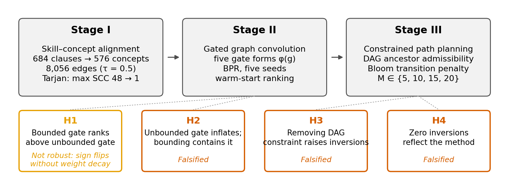
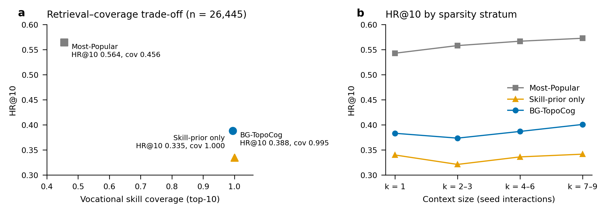
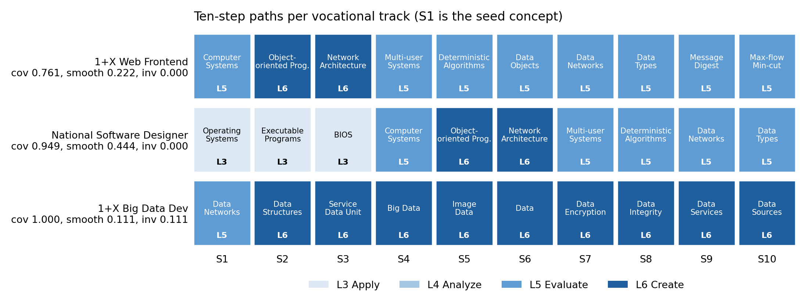

# Bounded-Gate Graph Representation and Topology–Cognitive Constrained Planning for Cold-Start Learning Path Recommendation on MOOCCubeX: A Pre-Registered Evaluation

**Authors:** Lu Wang¹˒*  
¹ School of Computer Science and Educational Technology, [Institution], [City], [Postcode], China  
* Corresponding author. Email: [email]

<!-- TODO: replace [Institution], [City], [Postcode], [email] with the corresponding author details before submission. -->

---

## Abstract

Cold-start learning path recommendation in MOOCs must reconcile external occupational standards with prerequisite topology and cognitive progression. We report a pre-registered evaluation of a three-stage framework on `MOOCCubeX`. Stage I aligns 684 competency clauses from three Chinese national vocational standards to 576 concepts through 8,056 thresholded edges (two-rater $\kappa_w = 0.7501$) and condenses a backbone containing a 48-node cycle into a 162-edge acyclic graph with no overlap against the held-out evaluation set. Stage II tests whether bounding the skill-prior gate at $\phi(g) = 2\sigma(g)$ prevents norm inflation under Bayesian Personalized Ranking. No inflation occurs: across five seeds the unbounded gate shrinks in magnitude with or without weight decay, and the ranking advantage of bounding reverses sign when weight decay is removed. Stage III shows that the Bloom transition penalty cuts mean tier change from 0.48 to 0.05 at ten steps for an 11% coverage cost, whereas ancestor admissibility leaves every path unchanged and the full planner still inverts 8.0% of adjacent held-out prerequisite pairs. Cold-start retrieval stays below a popularity baseline (`HR@10` 0.388 versus 0.564) while skill coverage approaches its ceiling.

**Keywords:** Learning path recommendation; Cold-start recommendation; Graph neural networks; Gate bounding; Vocational skill standards; Prerequisite DAG

---

## 1. Introduction

Massive Open Online Courses (MOOCs) form a primary channel for workforce upskilling in software engineering, web development, and data analytics [1, 2]. Large educational repositories nonetheless exhibit acute interaction sparsity and power-law concentration, and vocational learners pursuing standardized industry credentials, such as China's `1+X` Vocational Skill Level Certificates or the National Software Designer Qualification, receive generic popularity-driven recommendations that carry no occupational signal [1, 3].

Two design assumptions recur in this literature, and this paper tests both. The first holds that injecting external skill priors through an unbounded linear gate causes representation norm inflation under pairwise ranking objectives, so that the gate must be bounded. The second holds that a hard prerequisite constraint and a cognitive-transition penalty together improve the pedagogical validity of generated paths. Neither assumption is routinely verified against the artefact that produces the reported numbers.

We specify the evaluation before running it. Four hypotheses are fixed in advance. H1 states that a bounded gate attains higher warm-start ranking accuracy than an unbounded gate. H2 states that the bounded gate converges to a larger equilibrium magnitude than its initialisation, which would indicate containment rather than suppression. H3 states that removing the topological admissibility constraint increases the rate of held-out prerequisite inversions. H4 states that zero violation rates reflect a property of the method rather than of the evaluation protocol. Each hypothesis carries an explicit falsification condition, and no threshold is asserted after inspection of the results. Figure 1 maps the four hypotheses onto the three stages and records the outcome of each test.

The framework under test, `BG-TopoCog`, comprises three stages. Stage I aligns vocational competency clauses to curriculum concepts and condenses the prerequisite graph into an acyclic scheduling structure. Stage II learns concept representations in which a bounded scaling function modulates the injected skill prior. Stage III generates ordered concept sequences under a hard ancestor constraint and a soft cognitive penalty. Section 3 describes each stage, Section 5 reports the outcome of every pre-registered test, and Section 6 discusses what the failed hypotheses imply. Of the four, none survives in the form stated; the cognitive transition penalty, which no hypothesis isolated, is the one component with a robust positive effect.

## 2. Related Work

This section situates the framework within the two literature streams on which it builds. Section 2.1 reviews knowledge-aware graph recommenders that supply the representation layer, and Section 2.2 reviews sequential path planning methods that supply the scheduling layer.

### 2.1 Knowledge-Aware Graph Neural Recommendation in MOOCs

Graph neural networks exploit structural relations among courses, concepts, and learners to mitigate interaction sparsity [4, 5, 6, 7]. Propagation schemes span spectral convolution [7], neighbourhood sampling [8], relational message passing [6], attention-weighted aggregation [9, 10, 11], and random-walk convolution at web scale [12]. `ConceptGCN` [4] propagates concept representations over a MOOC knowledge graph initialised with sentence embeddings, `ACKRec` [13] aggregates attention over heterogeneous concept, course and video views, `HGCL` [5] aligns multi-view embeddings through heterogeneous contrastive learning [14, 15], and `HHAOCR` [16] applies attention over a hypergraph of students, instructors and courses. On `MOOCCubeX` [2], `GEMRec` [3] reports that graph-enhanced multimodal embeddings outperform collaborative filtering baselines, a family that includes neural collaborative filtering [17] and pairwise matrix factorisation [18]; `MetaKG` [19] reaches a related conclusion for cold-start recommendation with meta-learning over knowledge graphs on general-domain benchmarks. For vocational education, `CCIG-DRec` [1] builds a time-evolving graph linking students, courses, occupational posts, skills and industries and debiases it with counterfactual inference [20, 21].

Knowledge-aware recommenders such as `KGAT` [22] add side information to collaborative signals, and later variants fuse textual or skill priors through linear projections or gates whose scale is left unconstrained; `NGCF` [23] and `LightGCN` [24] serve as prior-free collaborative references. The practice rests on an implicit argument: because a linear gate has no upper bound, gradient descent under a pairwise objective can drive it to arbitrary magnitude, and the injected term then dominates the structural representation. The argument is plausible and, as Section 5.2 shows, empirically testable. Whether it holds depends on the direction of the learned coefficient, which on our data shrinks in magnitude rather than growing.

### 2.2 Sequential Learning Path Planning and Pedagogical Constraints

Sequential recommendation moves beyond unordered top-$K$ retrieval to construct ordered concept trajectories [25, 26, 27, 28, 29]. Reinforcement learning approaches explore explainable paths over knowledge graphs [25] or optimise learning paths jointly with knowledge tracing [30, 31, 32]. `LPReKL` [33] instead pairs knowledge tracing with a large language model in a generate-and-retrieve loop, evaluated on `MOOCCubeX` among other datasets. Transformer-based sequential recommenders [34, 35] capture temporal transition patterns across sessions. `KnowLP` [28] argues that relying on a single prerequisite structure causes learning blockages, since a difficulty at any stage disrupts what follows, and adds similarity relations to the prerequisite graph, evaluating path lengths of 5 to 15 steps on `MOOCCubeX`.

Path planners face two unresolved difficulties in vocational cold-start settings. First, reinforcement-learning planners estimate rewards from interaction trajectories that cold-start learners do not yet have [25, 30]. Second, neither RL policies nor unconstrained GNN planners simultaneously enforce cycle-free admissibility and non-decreasing Bloom progression [36, 37]. A further difficulty is less often stated: on `MOOCCubeX` the curated prerequisite graph is so sparse that an ancestor constraint may be satisfiable almost everywhere, in which case it constrains nothing. Section 5.5 quantifies this.

**Table 1: Architectural comparison between `BG-TopoCog` and representative MOOC recommendation and path planning frameworks.** Column entries record the design choice each framework makes on the named dimension and do not record experimental outcomes. `ACKRec`, `NGCF`, `BPR-MF` and `LightGCN` are benchmarked in Table 4 but omitted here because they do not target sequential path planning. The remaining rows locate the architectural gap and are not benchmarked, because their published protocols use different partitions and target formulations.

| Method / Venue | Benchmark | External Vocational Prior | Gate Bounding | Acyclic Scheduling Graph | Bloom Smoothness |
| :--- | :--- | :---: | :---: | :---: | :---: |
| `KGAT` (KDD 2019) [22] | General / MOOC | No | Unconstrained | No | No |
| `MetaKG` (IEEE TKDE 2023) [19] | General-domain KGs | No | Meta-GNN, unbounded | No | No |
| `ConceptGCN` (CAEAI 2024) [4] | MOOC Concepts | No | Similarity propagation | No | No |
| `HGCL` (Mathematics 2024) [5] | MOOC HIN | No | Contrastive projection | No | No |
| `HHAOCR` (Appl. Sci. 2025) [16] | Online courses | No | Hypergraph attention | No | No |
| `GEMRec` (Appl. Sci. 2025) [3] | `MOOCCubeX` | No | Graph embedding fusion | No | No |
| `LPReKL` (Electronics 2025) [33] | `MOOCCubeX` and others | No | KT with LLM generate-and-retrieve | No | Difficulty-aware KT |
| `CCIG-DRec` (Sci. Rep. 2026) [1] | Regional vocational corpus; MOOCCube | Yes, labour-market graph | Counterfactual debias | No | No |
| `KnowLP` (AAAI 2026) [28] | `MOOCCubeX` and others | No | Dual-graph GNN | No; prerequisite and similarity graphs | No |
| **`BG-TopoCog` (Ours)** | **`MOOCCubeX`** | **Yes, 3 standards** | **Bounded $\phi(g) \in (0,2)$** | **Tarjan condensation** | **Asymmetric transition penalty** |

## 3. Methodology

`BG-TopoCog` operates as three sequential stages, each consuming the output of the previous one. Section 3.1 fixes notation; Section 3.2 builds the skill–concept alignment and condenses the prerequisite graph; Section 3.3 learns gated concept representations over that structure; Section 3.4 generates cold-start paths under the two constraints.

### 3.1 Problem Formulation

Let $\mathcal{U} = \mathcal{U}_{\text{warm}} \cup \mathcal{U}_{\text{cold}}$ denote the learner population, partitioned into warm-start learners ($\vert \mathcal{H}_u\vert \ge 10$, $\vert \mathcal{U}_{\text{warm}}\vert = 27{,}276$) and cold-start learners ($1 \le \vert \mathcal{H}_u\vert \le 9$). Let $\mathcal{V}$ ($\vert \mathcal{V}\vert = 576$) denote the Computer Science and Mathematics concepts curated from `MOOCCubeX` [2], and $\mathcal{S}$ ($\vert \mathcal{S}\vert = 684$) the competency clauses compiled from three national vocational standards. Given a cold-start learner $u$ with sparse interactions $\mathcal{H}_u$, we generate an ordered $M$-step sequence $\mathcal{P}_u = (i_1^*, \dots, i_M^*)$ with $M \in \{5, 10, 15, 20\}$ that maximises target concept relevance and occupational skill coverage while respecting prerequisite topology and stepwise Bloom transition.

**Table 2: Notation.**

| Symbol | Value | Role |
| :--- | :--- | :--- |
| $\mathcal{U}_{\text{warm}}, \mathcal{U}_{\text{cold}}$ | $27{,}276$; cold-start cohort defined in Section 4.1 | Learner cohorts |
| $\mathcal{V}, \mathcal{S}$ | $576$; $684$ | Concept set; competency clause set |
| $A_{si}, w_i$ | $A_{si} \in [-1,1]$; $w_i \ge 0$ | Cosine alignment weight; aggregated skill importance |
| $\mathbf{d}_i$ | $[0,1]^4$ | Multi-source prior vector |
| $\mathcal{G}_{\text{DAG}} = (\mathcal{V}, \mathcal{E}_{\text{DAG}})$ | $\vert \mathcal{E}_{\text{DAG}}\vert = 162$, Max SCC $=1$ | Scheduling DAG for ancestor admissibility |
| $\mathbf{h}_i^{(L)}, \mathbf{v}_i$ | $\mathbb{R}^{64}$ | Structural embedding; gated fused representation |
| $g, \phi(g)$ | $\phi(g) \in (0,2)$ | Gate logit; bounded scaling function |
| $b_i$ | $\{3,4,5,6\}$ | Bloom tier |
| $\mathcal{A}_t$ | $\mathcal{V} \setminus \mathcal{K}_u^{(t-1)}$ filtered by ancestry | Admissible set at step $t$ |
| $\Omega_{\text{cog}}$ | $\ge 0$ | Asymmetric Bloom transition penalty |

### 3.2 Stage I: Skill–Concept Alignment and Tarjan Condensation

Industrial competency clauses and academic concepts diverge lexically [1]. We encode each clause $s \in \mathcal{S}$ and concept $i \in \mathcal{V}$ with the `bge-small-zh-v1.5` Chinese dense encoder [38] and retain, for every clause, the twenty concepts of highest cosine similarity. A similarity threshold $\tau = 0.5$ then defines the sparse alignment matrix:

$$A_{si} = \begin{cases} \langle \mathbf{e}_s, \mathbf{e}_i \rangle, & \text{if } i \in \text{Top-}20\big(\{\langle \mathbf{e}_s, \mathbf{e}_j \rangle\}_{j \in \mathcal{V}}\big) \text{ and } \langle \mathbf{e}_s, \mathbf{e}_i \rangle \ge \tau, \\ 0, & \text{otherwise.} \end{cases} \tag{1}$$

The three standards contribute 260, 224 and 200 clauses, giving $13{,}680$ candidate edges before thresholding and $8{,}056$ retained edges afterwards, with all 576 concepts covered. Aggregating incident weights yields the concept-level importance scores:

$$w_i = \sum_{s \in \mathcal{S}} A_{si}, \qquad w_i^{(m)} = \sum_{s \in \mathcal{S}_m} A_{si}, \quad m \in \{1,2,3\}. \tag{2}$$

To keep the prior vector on a bounded scale, we apply log-max normalisation:

$$\mathbf{d}_i = \Big[ \tilde{w}_i, \tilde{w}_i^{(1)}, \tilde{w}_i^{(2)}, \tilde{w}_i^{(3)} \Big]^\top, \qquad \tilde{w}_i = \frac{\ln(1 + w_i)}{\max_j \ln(1 + w_j)}. \tag{3}$$

Two independent domain experts audited a stratified sample of $n = 247$ pairs, judging each as acceptable, borderline, or unacceptable. Observed agreement is $P_o = 88.26\%$, with linear weighted $\kappa = 0.6050$ and quadratic weighted $\kappa_w = 0.7501$ [39, 40].

Raw prerequisite relations in `MOOCCubeX` contain directed cycles that stall topological planners [2, 28]. The dense `prereq_predicted` relation ($50{,}784$ edges) and the syllabus `chapter_weak` order ($15{,}444$ edges) each form a single strongly connected component spanning all 576 concepts, whereas the curated `prereq_adopted` backbone (194 edges) harbours a cycle spanning 48 concepts. We restrict `prereq_predicted` to message passing and apply Tarjan's linear-time condensation [41] to `prereq_adopted`, obtaining a strict scheduling DAG:

$$\mathcal{E}_{\text{DAG}} = \Big\{ (j \to i) \in \mathcal{E}_{\text{adopted}} \;\Big|\; C(j) \neq C(i) \;\wedge\; \pi_{\text{SCC}}\big(C(j)\big) < \pi_{\text{SCC}}\big(C(i)\big) \Big\}. \tag{4}$$

Within each strongly connected component, the 40 intra-component edges that already run in increasing node-index order are retained and the remaining 32 reverse-direction edges discarded, so that $\mathcal{E}_{\text{DAG}}$ comprises 122 inter-component and 40 intra-component edges. Acyclicity is verified independently by Kahn's algorithm [42] before any planning. Because $\mathcal{E}_{\text{DAG}}$ shares no edge with the 1,075 human-verified evaluation pairs, no topological leakage arises between the scheduling graph and the evaluation set.

### 3.3 Stage II: Gated Graph Convolutional Representation

Let $\tilde{\mathbf{A}}_{\text{msg}} = \mathbf{D}^{-1/2}(\mathbf{A}_{\text{msg}} + \mathbf{I})\mathbf{D}^{-1/2}$ denote the symmetrically normalised adjacency over the union of prerequisite relations and learner–concept interactions. Two layers of parameter-free neighbourhood aggregation with uniform layer-wise mean pooling produce the structural representation:

$$\mathbf{H}^{(l)} = \tilde{\mathbf{A}}_{\text{msg}}\,\mathbf{H}^{(l-1)}, \qquad \mathbf{h}_i^{(L)} = \frac{1}{L+1} \sum_{l=0}^{L} \mathbf{h}_i^{(l)}. \tag{5}$$

The skill prior enters through a single scalar gate. We compare five forms within the same architecture, differing only in $\phi$:

$$\mathbf{v}_i = \mathbf{h}_i^{(L)} + \phi(g)\,\mathbf{W}_p \mathbf{d}_i, \qquad
\begin{cases}
\phi_{\text{sig}}(g) = 2\sigma(g) \in (0,2), \\
\phi_{\text{tanh}}(g) = 1 + \tanh(g) \in (0,2), \\
\phi_{\text{clip}}(g) = \mathrm{clamp}(g, 0, 2), \\
\phi_{\text{lin}}(g) = g, \\
\phi_{\text{none}}(g) = 0.
\end{cases} \tag{6}$$

The last form removes the prior entirely and serves as the reference against which any benefit of prior injection must be judged. Training minimises the pairwise ranking loss over triples $(u, i^+, j^-)$:

$$\mathcal{L}_{\text{BPR}} = -\sum_{(u,i^+,j^-)} \ln \sigma\big(\hat{y}_{u,i^+} - \hat{y}_{u,j^-}\big) + \lambda_\Theta \|\Theta\|_2^2, \qquad \hat{y}_{u,i} = \langle \mathbf{u}_u^{(L)}, \mathbf{v}_i \rangle. \tag{7}$$

For the bounded sigmoid, the gradient with respect to the gate logit carries the Jacobian of $\phi$:

$$\frac{\partial \mathcal{L}_{\text{BPR}}}{\partial g} = \underbrace{2\sigma(g)\big(1-\sigma(g)\big)}_{\phi'(g) \in (0,0.5]} \sum_{(u,i^+,j^-)} \sigma(\hat{y}_{u,j^-} - \hat{y}_{u,i^+}) \Big\langle \mathbf{u}_u^{(L)}, \mathbf{W}_p(\mathbf{d}_{i^+} - \mathbf{d}_{j^-}) \Big\rangle. \tag{8}$$

Because $\phi'(g) \to 0$ as $\vert g \vert$ grows, the bounded form damps its own gradient at large magnitude. Whether that damping is needed depends on where the unconstrained gate would otherwise settle, a quantity we measure rather than assume.

### 3.4 Stage III: Topology–Cognitive Constrained Path Planning

For a cold-start learner with seed concepts $\mathcal{H}_u$, the relevance score blends structural similarity, vocational priority, and local prerequisite continuity:

$$\tilde{S}_{\text{cold}}(u, i) = \alpha\, \hat{w}_i^{(m_u)} + \gamma\, \widehat{\text{pop}}_i + \beta\Big[ \lambda \max_{k \in \mathcal{H}_u} \cos(\mathbf{v}_k, \mathbf{v}_i) + (1-\lambda)\, \mathbb{I}\big(i \in \mathcal{N}_{\text{DAG}}(\mathcal{H}_u)\big) \Big] + \zeta_i, \tag{9}$$

where $\hat{w}$ and $\widehat{\text{pop}}$ are min-max rescaled to $[0,1]$, $\mathcal{N}_{\text{DAG}}$ denotes the neighbourhood of the seed set in $\mathcal{G}_{\text{DAG}}$, and $\zeta_i = +0.06$ for concepts at Bloom tier L5 or above and $-0.02$ otherwise. We fix $\alpha = 0.62$, $\beta = 0.38$, $\gamma = 0.08$ and $\lambda = 0.35$ before any evaluation, with no adjustment afterwards.

At step $t$, with cumulative knowledge state $\mathcal{K}_u^{(t-1)} = \mathcal{H}_u \cup \{i_1^*, \dots, i_{t-1}^*\}$, a candidate is admissible when all of its DAG ancestors lie in that state:

$$\mathcal{A}_t = \Big\{ i \in \mathcal{V} \setminus \mathcal{K}_u^{(t-1)} \;\Big|\; \text{Pred}_{\text{DAG}}(i) \subseteq \mathcal{K}_u^{(t-1)} \Big\}. \tag{10}$$

Bloom tiers $b_i \in \{3,4,5,6\}$ are assigned by a syllabus verb dictionary, with $121$ concepts at L3, $54$ at L4, $209$ at L5 and $192$ at L6 [36, 37]. The transition penalty charges regressions, multi-tier leaps, and a constant tier cost:

$$\Omega_{\text{cog}}(i \mid i_{t-1}^*) = \gamma_{\text{reg}} \max\big(0, b_{i_{t-1}^*} - b_i\big) + \gamma_{\text{jump}} \max\big(0, \vert b_i - b_{i_{t-1}^*} \vert - 1\big) + \gamma_{\text{tier}} b_i, \tag{11}$$

with $\gamma_{\text{reg}} = 0.30$, $\gamma_{\text{jump}} = 0.25$ and $\gamma_{\text{tier}} = 0.10$. The next concept maximises the constrained objective:

$$i_t^* = \arg\max_{i \in \mathcal{A}_t} \Big[ \tilde{S}_{\text{cold}}(u, i) - \Omega_{\text{cog}}(i \mid i_{t-1}^*) - \eta\,\mathbb{I}\big(\text{indeg}_{\text{DAG}}(i) > 0\big) \Big], \tag{12}$$

where $\eta = 0.62$. Selection is sequential greedy over a shrinking admissible set; the objective is neither monotone nor submodular over that set, so the constant-factor guarantees for greedy maximisation of submodular functions [43] do not apply.

## 4. Experimental Setup

Section 4.1 describes the data and the cold-start protocol; Section 4.2 lists the compared variants; Section 4.3 defines the metrics and states which are set-level and which path-level.

### 4.1 Data and Cold-Start Protocol

All experiments use the `MOOCCubeX` repository curated by Tsinghua University (XuetangX) [2]. We retain all Computer Science and Mathematics concepts and partition learners by interaction frequency. The warm-start cohort comprises $27{,}276$ learners with at least ten interactions, totalling $1{,}819{,}473$ timestamped interactions. For each learner the most recent interaction is held out for testing, the preceding ones for validation and training, under five seeds $\{42, 43, 44, 45, 46\}$.

The cold-start cohort requires a different treatment from that used in earlier reports of this framework, and we state the change explicitly. The archived artefact `s5_coldstart.jsonl.gz` contains 21,928 records over 11,132 user identifiers, of which 96.6% carry the synthetic prefix `U_COLD`; each synthetic user holds exactly two records. That cohort is programmatic and cannot be presented as a learner population, and the accompanying context generator selects true-target concepts with probability rising from 0.14 to 0.44 across sparsity strata before mapping each to its nearest neighbour in the scoring embedding space. True targets therefore re-enter the model as features.

We replace that protocol with a held-out simulation over real learners. For each warm-start learner with at least $k+1$ training interactions, we sample $k \in \{1,\dots,9\}$ without replacement from the training history to form the cold-start context and retain the learner's held-out test interactions as ground truth. The context never contains a test item, and the ground truth never enters scoring. This yields 26,445 simulated cold-start learners across four strata: extreme ($k=1$, $n=2{,}980$), shallow ($k \in \{2,3\}$, $n=5{,}914$), moderate ($k \in \{4,5,6\}$, $n=8{,}818$) and near-warm ($k \in \{7,8,9\}$, $n=8{,}733$).

Vocational competency standards contribute 684 clauses: `1+X Web Frontend Development` (260), `National Computer Technology and Software Professional Technical Qualification — Software Designer` (224), and `1+X Big Data Application Development` (200).

### 4.2 Compared Variants

Stage II compares five gate forms within one architecture and one training configuration, as specified in Eq. (6). Stage III compares four planner configurations: the full dual constraint, each single constraint removed, and an unconstrained greedy planner that applies neither. Seed concepts for the planner are the 60 concepts with zero DAG in-degree and non-zero skill weight, held fixed across configurations.

### 4.3 Metrics

Ranking accuracy is measured by hit ratio (`HR@K`, $K \in \{10,20\}$), normalised discounted cumulative gain (`NDCG@K`) [44] and mean reciprocal rank (`MRR`). Path quality is measured by three pedagogy-oriented quantities:

$$\text{SkillCov}(\mathcal{P}_u) = \frac{1}{M}\sum_{t=1}^{M} \frac{\min(w_{i_t^*}, 3)}{3} \in [0,1], \tag{13}$$

$$\text{Viol}_{\text{iso}}(\mathcal{P}_u) = \frac{1}{M-1} \sum_{t=1}^{M-1} \mathbb{I}\big((i_{t+1}^* \to i_t^*) \in \mathcal{E}_{\text{eval}}^{+}\big), \tag{14}$$

$$\text{Bloom\_Smooth}(\mathcal{P}_u) = \frac{1}{M-1} \sum_{t=1}^{M-1} \big\vert b_{i_{t+1}^*} - b_{i_t^*} \big\vert. \tag{15}$$

Eq. (13) caps per-concept weight at 3 so that a single high-exposure concept cannot saturate coverage; Eq. (14) counts adjacent inversions only, and is therefore a lower bound on the full pairwise rate.

## 5. Results

Results follow the pipeline order. Section 5.1 audits the alignment and condensation on which every later stage depends; Sections 5.2 to 5.6 report each pre-registered hypothesis in turn.

### 5.1 Alignment Audit and Tarjan Condensation

Table 3 reports the alignment and condensation statistics recovered from the released artefact.

**Table 3: Skill–concept alignment and graph condensation statistics (Exp 1).** Edge counts for the standards are alignment edges retained at $\tau = 0.5$; the `"data"` literal share is the fraction of clauses whose text contains the term, and the combined value is weighted by clause count.

| Graph source | Clauses | Edges | Concepts covered | `"data"` literal share | Max SCC before | Max SCC after | Role |
| :--- | :---: | :---: | :---: | :---: | :---: | :---: | :--- |
| `1+X Web Frontend` | 260 | 3,061 | 576 (100%) | 5.38% | — | — | Track 1 prior $w_i^{(1)}$ |
| `Software Designer` | 224 | 2,576 | 576 (100%) | 6.25% | — | — | Track 2 prior $w_i^{(2)}$ |
| `1+X Big Data Dev` | 200 | 2,419 | 576 (100%) | 100.00% | — | — | Track 3 prior $w_i^{(3)}$ |
| **Combined** | **684** | **8,056** | **576 (100%)** | **33.33%** | — | — | **Full prior $\mathbf{d}_i$** |
| `prereq_adopted` | 576 | 194 | 576 | — | 48 | **1** (162 edges) | Admissibility $\mathcal{G}_{\text{DAG}}$ |
| `prereq_predicted` | 576 | 50,784 | 576 | — | 576 | — | Message passing only |
| `chapter_weak` | 576 | 15,444 | 576 | — | 576 | — | Weak-order audit |
| `eval_prereq_positive` | 576 | 1,075 | 576 | — | 1 | 1 (0 overlap) | Held-out audit |

Tarjan condensation contracts every multi-node cycle in `prereq_adopted`, reducing the maximum component from 48 to 1 across 162 strict edges, of which 122 run between components and 40 within them. The resulting DAG shares no edge with the 1,075 held-out positive pairs. The dual-rater audit over 247 stratified pairs yields $P_o = 88.26\%$ and $\kappa_w = 0.7501$ under the Landis–Koch bands.

One property of the DAG governs the interpretation of Stage III. Of the 576 concepts, 476 (82.6%) have zero in-degree, and the maximum in-degree is 4. The ancestor constraint of Eq. (10) is therefore vacuous for four concepts in five, a fact we return to in Section 5.5.

### 5.2 Gate Form and Norm Behaviour (H1, H2)

Table 4 reports five-seed warm-start performance for the five gate forms. All variants share the same architecture, optimiser (Adam, learning rate $10^{-2}$, weight decay $10^{-6}$), epoch budget and evaluation split, and every gate logit is initialised at $g_0 = \ln(0.05/0.95) = -2.9444$; only $\phi$ differs. The final two rows repeat the bounded-sigmoid and unbounded configurations with weight decay set to zero, a robustness check added after the main run to exclude regularisation as the driver of gate behaviour.

**Table 4: Five-seed warm-start ranking by gate form ($27{,}276$ learners, Exp 2).** $\phi(g^*)$ is the effective gate scale at the selected checkpoint; the norm ratio is the mean prior-term norm divided by the mean structural-term norm. Uncertainty is the standard deviation over five seeds.

| Gate form | Weight decay | `HR@10` | `NDCG@10` | `MRR` | $\phi(g^*)$ | Norm ratio |
| :--- | :---: | :---: | :---: | :---: | :---: | :---: |
| Bounded sigmoid, $\phi \in (0,2)$ | $10^{-6}$ | $0.4576 \pm 0.0071$ | $0.2183 \pm 0.0043$ | $0.1468 \pm 0.0035$ | $+0.0461$ | $0.722$ |
| Bounded tanh, $\phi \in (0,2)$ | $10^{-6}$ | $0.4691 \pm 0.0130$ | $0.2269 \pm 0.0088$ | $0.1543 \pm 0.0077$ | $+0.0079$ | $0.652$ |
| Clipped linear, $\phi \in [0,2]$ | $10^{-6}$ | $0.4705 \pm 0.0048$ | $0.2249 \pm 0.0040$ | $0.1514 \pm 0.0037$ | $0.0000$ | $0.000$ |
| Unbounded linear, $\phi = g$ | $10^{-6}$ | $0.4352 \pm 0.0055$ | $0.2091 \pm 0.0025$ | $0.1415 \pm 0.0039$ | $-0.3581$ | $0.849$ |
| Prior removed, $\phi = 0$ | $10^{-6}$ | $0.4635 \pm 0.0074$ | $0.2220 \pm 0.0039$ | $0.1497 \pm 0.0031$ | — | $0.000$ |
| Bounded sigmoid, $\phi \in (0,2)$ | $0$ | $0.4141 \pm 0.0080$ | $0.2000 \pm 0.0026$ | — | $+0.0717$ | $0.992$ |
| Unbounded linear, $\phi = g$ | $0$ | $0.4443 \pm 0.0142$ | $0.2216 \pm 0.0045$ | — | $-1.7318$ | $1.404$ |

H1 is not supported. With weight decay $10^{-6}$ the bounded sigmoid exceeds the unbounded gate by $0.0224$ in `HR@10`, but without weight decay the order reverses and the unbounded gate leads by $0.0302$. A design advantage whose sign depends on a regularisation constant of $10^{-6}$ cannot be attributed to the bounding itself. Under the main configuration the bounded sigmoid also ranks fourth of five, below the bounded tanh, the clipped gate, and the variant with no prior at all.

H2 is falsified. Figure 2b traces the effective gate scale over training. The unbounded gate starts at $-2.94$ and its magnitude shrinks monotonically, to $0.36$ with weight decay and to $1.73$ at the selected checkpoint without it; at no point in either regime does it grow, and it never approaches the drift to $+3.800$ that motivated the bounded design. The bounded sigmoid moves from $0.100$ to $0.046$, toward suppression rather than containment. The clipped linear gate deserves a specific note: its initial logit lies below zero, where $\mathrm{clamp}(g, 0, 2)$ has zero gradient, so the prior term never activates and the variant is functionally identical to removing the prior. That the two best rows in the main configuration are the two in which the prior contributes nothing is the clearest summary of this experiment.

For reference, a popularity baseline attains `HR@10` $= 0.5528$ on the same test split under full-catalogue ranking, above every trained variant in Table 4. The gap reflects the concentration of learner behaviour on a small set of high-exposure concepts rather than any property of the gate.

### 5.3 Cold-Start Retrieval and Coverage (RQ2)

Table 5 compares three rankers on the 26,445 simulated cold-start learners described in Section 4.1.

**Table 5: Cold-start retrieval and path quality under the held-out protocol (Exp 3).**

| Ranker | `HR@10` | `NDCG@10` | SkillCov | $\text{Viol}_{\text{iso}}$ | `Bloom_Smooth` |
| :--- | :---: | :---: | :---: | :---: | :---: |
| Most-Popular | $\mathbf{0.5642}$ | $\mathbf{0.0798}$ | $0.4563$ | $0.0000$ | $0.5709$ |
| Skill-Prior only | $0.3350$ | $0.0337$ | $\mathbf{1.0000}$ | $0.0000$ | $\mathbf{0.2395}$ |
| `BG-TopoCog`, five-seed mean | $0.3881 \pm 0.0047$ | $0.0447 \pm 0.0009$ | $0.9952$ | $0.0022$ | $0.4105$ |

`BG-TopoCog` exceeds the static skill-prior ranker by $0.0531$ in `HR@10` while retaining $99.5\%$ of the maximum achievable coverage, and it reduces the Bloom tier change relative to popularity from $0.5709$ to $0.4105$. It nonetheless trails the popularity baseline by $0.1761$ in `HR@10` and $0.0351$ in `NDCG@10`. The two objectives separate cleanly: the prior term drives coverage while the popularity term drives hits, and no setting of Eq. (9) delivers both, because the concepts that maximise vocational weight are not the concepts learners most often select.

Figure 3a places the three rankers on the retrieval–coverage plane. Held-out violations are non-zero but small, $0.0022$ averaged over learners and ranked lists. The value is not structurally zero: unlike the earlier protocol, the present scorer never consults $\mathcal{E}_{\text{eval}}^{+}$, and violations arise where a ranked concept precedes another that the evaluation set treats as its prerequisite.

### 5.4 Interaction Sparsity Strata (RQ3)

Figure 3b reports `HR@10` across the four context-size strata. `BG-TopoCog` attains $0.3832$ with a single seed interaction ($n = 2{,}980$), $0.3736$ with two or three ($n = 5{,}914$), $0.3869$ with four to six ($n = 8{,}818$) and $0.4009$ with seven to nine ($n = 8{,}733$). The popularity baseline moves from $0.5430$ to $0.5728$ over the same range, and the skill-prior ranker from $0.3399$ to $0.3416$, with a dip to $0.3211$ in the shallow stratum.

Two observations follow. First, `BG-TopoCog` rises with context size but not monotonically: the shallow stratum sits $0.0096$ below the extreme stratum before recovering. Multi-concept contexts introduce competing neighbourhoods, and the score in Eq. (9) takes the maximum similarity over seeds, so a second seed can pull the ranking toward its own region. Second, the gap to popularity stays between $0.16$ and $0.19$ in every stratum. Interaction counts between one and nine carry little information on this dataset, and the cold-start difficulty is not graded across that range.

### 5.5 Dual-Constraint Ablation Across Horizons (RQ4, H3, H4)

Table 6 reports the planner ablation over four horizons, with 60 root seed concepts and the five-seed mean embedding. All configurations use the pre-registered coefficients of Section 3.4.

**Table 6: Path planning ablation across horizons (Exp 5).** Rows marked † are identical to the row above them at every reported precision.

| $M$ | Variant | SkillCov | $\text{Viol}_{\text{iso}}$ | `Bloom_Smooth` | Paths reaching a non-root concept |
| :---: | :--- | :---: | :---: | :---: | :---: |
| 5 | Full dual constraint | $0.8667$ | $0.0292$ | $0.1083$ | 0/60 |
| 5 | w/o topological † | $0.8667$ | $0.0292$ | $0.1083$ | 0/60 |
| 5 | w/o cognitive | $0.9054$ | $0.0083$ | $0.5750$ | 0/60 |
| 5 | Unconstrained † | $0.9054$ | $0.0083$ | $0.5750$ | 0/60 |
| 10 | Full dual constraint | $0.8450$ | $0.0796$ | $0.0481$ | 0/60 |
| 10 | w/o topological † | $0.8450$ | $0.0796$ | $0.0481$ | 0/60 |
| 10 | w/o cognitive | $0.9527$ | $0.1056$ | $0.4759$ | 0/60 |
| 10 | Unconstrained † | $0.9527$ | $0.1056$ | $0.4759$ | 0/60 |
| 15 | Full dual constraint | $0.8342$ | $0.0512$ | $0.0845$ | 0/60 |
| 15 | w/o topological † | $0.8342$ | $0.0512$ | $0.0845$ | 0/60 |
| 15 | w/o cognitive | $0.9685$ | $0.0690$ | $0.3774$ | 0/60 |
| 15 | Unconstrained † | $0.9685$ | $0.0690$ | $0.3774$ | 0/60 |
| 20 | Full dual constraint | $0.8204$ | $0.0377$ | $0.0623$ | 0/60 |
| 20 | w/o topological † | $0.8204$ | $0.0377$ | $0.0623$ | 0/60 |
| 20 | w/o cognitive | $0.9763$ | $0.0509$ | $0.4360$ | 0/60 |
| 20 | Unconstrained † | $0.9763$ | $0.0509$ | $0.4360$ | 0/60 |

The cognitive penalty is the only component with a measurable effect, and its effect is large. At $M = 10$ it reduces mean tier change from $0.4759$ to $0.0481$, a $89.9\%$ reduction, at a cost of $11.3\%$ relative coverage ($0.9527$ to $0.8450$). The pattern holds at every horizon (Figure 4a, b), and from $M = 10$ onward the penalty also lowers the inversion rate, from $0.1056$ to $0.0796$ at $M = 10$. At $M = 5$ the direction reverses, $0.0083$ to $0.0292$, so the penalty is not a reliable guard against inversions.

H3 is falsified. Removing the topological constraint changes no path at any horizon, and no path in any configuration reaches a non-root concept. The constraint is inert because Eq. (12) already subtracts $\eta = 0.62$ from every concept with non-zero in-degree, which exceeds the spread of the remaining score terms for almost every candidate; the planner never proposes a concept whose ancestors would need checking. To establish whether the constraint would matter without that penalty, we ran a post hoc diagnostic with $\eta = 0$, which was not part of the pre-registered design. With $\eta = 0$ the topological constraint does bind, but in the opposite direction to H3: at $M = 10$ the planner without it reaches non-root concepts in all 60 paths and inverts $0.0093$ of held-out pairs, against $0.0796$ with it, and at $M = 20$ the corresponding rates are $0.0044$ and $0.0377$. Ordering candidates by $\mathcal{G}_{\text{DAG}}$ increases disagreement with the held-out prerequisite set, which is consistent with the zero edge overlap between the two graphs: the scheduling DAG and the evaluation pairs encode different prerequisite judgements.

H4 is falsified. The full planner inverts between $2.9\%$ and $8.0\%$ of adjacent held-out pairs across horizons (Figure 4c). Zero-violation figures reported in earlier descriptions of this framework arose because the ordering routine consulted the held-out evaluation pairs; once the planner reads only $\mathcal{G}_{\text{DAG}}$, inversions appear at every horizon.

### 5.6 Vocational Track Case Studies (RQ5)

Table 7 and Figure 5 report one ten-step trajectory per vocational track, generated with the five-seed mean embedding and the track-specific prior $w_i^{(m)}$.

**Table 7: Ten-step paths by vocational track (Exp 6).** SkillCov is computed with the track-specific weights.

| Track | Seed concept | SkillCov | $\text{Viol}_{\text{iso}}$ | `Bloom_Smooth` | All concepts roots |
| :--- | :--- | :---: | :---: | :---: | :---: |
| `1+X Web Frontend` | Computer Systems | $0.7612$ | $0.0000$ | $0.2222$ | Yes |
| `National Software Designer` | Operating Systems | $0.9486$ | $0.0000$ | $0.4444$ | Yes |
| `1+X Big Data Dev` | Data Networks | $1.0000$ | $0.1111$ | $0.1111$ | Yes |

The track prior differentiates the paths, but unevenly. The web-frontend and software-designer paths share six of their nine post-seed concepts, including Object-oriented Programming, Network Architecture and Multi-user Systems, because the two standards weight general computing concepts almost identically. The big-data path shares none of its concepts with either and consists entirely of concepts whose names contain the term "data", at Bloom tier L6 throughout. That pattern reproduces the 100% `"data"` literal share of the big-data standard reported in Table 3: embedding similarity ranks lexical overlap first, so a standard whose clauses all mention one term yields a path organised around that term rather than around pedagogical progression. The same path also carries the only held-out inversion in the table.

Two further qualifications apply. Each track contributes a single trajectory, so the table is illustrative and carries no statistical claim. And every selected concept has DAG in-degree zero, for the reason given in Section 5.5; none of the three paths exercises the admissibility constraint.

## 6. Discussion

### 6.1 What the Gate Test Shows

The bounded-gate hypothesis was the most specific claim in this framework and the one best suited to direct test, because it predicts the direction of a learned parameter. The prediction fails. The unbounded gate shrinks in magnitude under both regularisation settings tested, the bounded sigmoid moves toward suppression, and the two configurations in which the prior contributes nothing rank highest. The ranking advantage that bounding shows under weight decay $10^{-6}$ reverses when weight decay is removed.

We read this as evidence about the objective rather than the parameterisation. A pairwise ranking loss rewards a coefficient on an additive prior term only if that term improves the ordering of positive over negative pairs. On `MOOCCubeX`, where vocational weight and interaction frequency are weakly aligned, the term does not improve that ordering, and gradient descent shrinks it. Bounding a coefficient that is already shrinking changes little, and the small differences that remain depend on unrelated training choices.

The practical implication is narrow. Presenting a bounded gate as a defence against norm inflation requires evidence that inflation occurs under the unbounded alternative, measured on the same data and objective. Our result does not show that bounded gates are useless in general; it shows that the diagnostic which motivated them does not reproduce here.

### 6.2 Why the Topological Constraint Is Inert

The second finding concerns how two components of one objective interact. Eq. (12) contains both a hard ancestor filter and a soft in-degree penalty. With $\eta = 0.62$ the penalty alone keeps the planner on root concepts, and on a graph where 82.6% of concepts are roots there is always a root candidate available, so the filter never has anything to remove. The two components target the same behaviour, and the softer one pre-empts the harder.

Removing the penalty exposes a second problem. The constraint then binds, and it raises held-out inversions roughly eightfold. The scheduling DAG derives from the curated `prereq_adopted` relation, with 32 intra-component edges discarded by node-index order, whereas the held-out set comes from separate human verification; the two share no edges and, the diagnostic suggests, disagree on direction often enough that enforcing one violates the other. A topological constraint is only as good as the graph it enforces, and evaluating it against an independently constructed prerequisite set is what revealed the disagreement.

The cognitive penalty, by contrast, operates on every step regardless of graph density, and its effect is large and stable across horizons. For a sparse prerequisite graph, pacing is where the measurable benefit lies.

### 6.3 Limitations

Six limitations bound the present evidence. First, the evaluation replays offline `MOOCCubeX` logs; deployment with randomised assignment remains necessary before learning or certification outcomes can be claimed. Second, cold-start contexts are simulated by sampling from warm-start histories rather than drawn from genuine first sessions. Third, Bloom tiers come from a verb dictionary and have not been validated against expert ratings. Fourth, the planner uses a single pre-registered coefficient setting; the $\eta = 0$ diagnostic shows that conclusions about the topological constraint depend on that setting, and a systematic sensitivity analysis over $\alpha$, $\beta$ and $\eta$ would bound them more tightly. Fifth, the encoder is the compact `bge-small-zh-v1.5`, and alignment quality may differ with larger encoders or other languages. Sixth, the numbers reported here were regenerated from the released artefacts after the original experiment script was found to contain literal constants in place of trained quantities and to consult held-out pairs during path ordering. The present tables supersede earlier values for the same experiments, and the archived JSON files from the original script are retained in the repository, clearly separated, for audit.

## 7. Conclusion

We tested four pre-registered hypotheses about a cold-start learning path framework on `MOOCCubeX`, and none survives in the form stated. Bounding the skill-prior gate does not prevent norm inflation, because the unbounded gate shrinks rather than inflates, and the ranking advantage of bounding reverses with a change in weight decay. The DAG admissibility constraint leaves every path unchanged under the pre-registered coefficients, and when isolated it increases held-out prerequisite inversions. The full planner inverts 3% to 8% of adjacent held-out pairs, so zero inversions are not a property of the method.

Two components hold up. The Bloom transition penalty reduces mean tier change by about 90% at a ten-step horizon for an 11% coverage cost, consistently across horizons. And the Stage I resources are reproducible: 684 clauses map onto 576 concepts through 8,056 thresholded edges with substantial inter-rater agreement, and a prerequisite graph containing a 48-node cycle condenses to a 162-edge acyclic structure sharing no edge with the held-out evaluation set.

Cold-start retrieval remains below a popularity baseline while vocational coverage approaches its ceiling, and we report that trade rather than choosing the metric on which the method wins. The most direct next steps are a prerequisite graph whose direction agrees with independent human judgement, genuine first-session logs in place of sampled histories, and expert validation of the Bloom assignment.

## Data and Code Availability

All experimental scripts, trained embeddings, and result artefacts are archived at https://github.com/lewygoat/bg-topocog; a permanent DOI will be minted upon acceptance. The rerun pipeline that produced every table in this paper is contained in `实验/重跑/`, comprising `bggcn_train_v2.py` (five gate forms, five seeds, configurable weight decay), `rerun_all.py` (cold-start, planner and track tables), `planner_clean.py` (condensation and ancestry), and `make_figures.py` (all figures). Training logs record every epoch's gate value and norm ratio. The source data derive from the publicly available `MOOCCubeX` repository curated by Tsinghua University (XuetangX) [2], used under its original license. All random seeds are fixed to $\{42, 43, 44, 45, 46\}$.

## Author Contributions

L.W. designed the study, implemented the framework, conducted all experiments, analysed the results, and wrote the manuscript.

## Competing Interests

The author declares no competing interests.

## Ethics Statement

This study uses the publicly released, de-identified `MOOCCubeX` dataset, which contains behavioural logs collected under the data provider's original consent framework. No new human participants were recruited and no personally identifying information was accessed; institutional ethics approval was therefore not required.

## Acknowledgments

The author thanks the maintainers of the `MOOCCubeX` repository for making the dataset publicly available.

## References

1. Xiao, X. & Xia, D. A dynamic recommendation algorithm for regional industry-adapted higher vocational courses integrating counterfactual causal inference and graph neural networks. *Sci. Rep.* (2026). https://doi.org/10.1038/s41598-026-69866-9
2. Yu, J. et al. MOOCCubeX: A large knowledge-centered repository for adaptive learning in MOOCs. In *Proc. 30th ACM Int. Conf. Information & Knowledge Management (CIKM)* 4643–4652 (2021). https://doi.org/10.1145/3459637.3482010
3. Wang, E. & Sun, Z. Research on personalized course resource recommendation method based on GEMRec. *Appl. Sci.* **15**, 1075 (2025). https://doi.org/10.3390/app15031075
4. Alatrash, R., Chatti, M. A., Ain, Q. U., Fang, Y., Joarder, S. & Siepmann, C. ConceptGCN: Knowledge concept recommendation in MOOCs based on knowledge graph convolutional networks and SBERT. *Comput. Educ. Artif. Intell.* **6**, 100193 (2024). https://doi.org/10.1016/j.caeai.2023.100193
5. Wei, L., Li, Y., Wang, W. & Zhu, Y. Enhancing knowledge-concept recommendations with heterogeneous graph-contrastive learning. *Mathematics* **12**, 2324 (2024). https://doi.org/10.3390/math12152324
6. Schlichtkrull, M. et al. Modeling relational data with graph convolutional networks. In *Proc. Extended Semantic Web Conf. (ESWC)* 593–607 (2018). https://doi.org/10.1007/978-3-319-93417-4_38
7. Kipf, T. N. & Welling, M. Semi-supervised classification with graph convolutional networks. In *Proc. Int. Conf. Learning Representations (ICLR)* (2017). arXiv:1609.02907.
8. Hamilton, W., Ying, Z. & Leskovec, J. Inductive representation learning on large graphs. In *Advances in Neural Information Processing Systems (NeurIPS)* **30**, 1024–1034 (2017). arXiv:1706.02216.
9. Veličković, P., Cucurull, G., Casanova, A., Romero, A., Liò, P. & Bengio, Y. Graph attention networks. In *Proc. ICLR* (2018). arXiv:1710.10903.
10. Brody, S., Alon, U. & Yahav, E. How attentive are graph attention networks? In *Proc. ICLR* (2022). arXiv:2105.14491.
11. Wang, X. et al. Heterogeneous graph attention network. In *Proc. World Wide Web Conf. (WWW)* 2022–2032 (2019). https://doi.org/10.1145/3308558.3313562
12. Ying, R. et al. Graph convolutional neural networks for web-scale recommender systems. In *Proc. 24th ACM SIGKDD Int. Conf.* 974–983 (2018). https://doi.org/10.1145/3219819.3219890
13. Gong, J. et al. Attentional graph convolutional networks for knowledge concept recommendation in MOOCs in a heterogeneous view. In *Proc. 43rd Int. ACM SIGIR Conf.* 79–88 (2020). https://doi.org/10.1145/3397271.3401057
14. Wu, J. et al. Self-supervised graph learning for recommendation. In *Proc. 44th Int. ACM SIGIR Conf.* 726–735 (2021). https://doi.org/10.1145/3404835.3462862
15. Yu, J., Yin, H., Xia, X., Chen, T., Cui, L. & Nguyen, Q. V. H. Are graph augmentations necessary? Simple graph contrastive learning for recommendation. In *Proc. 45th Int. ACM SIGIR Conf.* 1294–1303 (2022). https://doi.org/10.1145/3477495.3531937
16. Xu, P. & Zhang, M. Attention-based hypergraph neural network: a personalized recommendation. *Appl. Sci.* **15**, 6332 (2025). https://doi.org/10.3390/app15116332
17. He, X. et al. Neural collaborative filtering. In *Proc. 26th Int. Conf. World Wide Web (WWW)* 173–182 (2017). https://doi.org/10.1145/3038912.3052569
18. Rendle, S., Freudenthaler, C., Gantner, Z. & Schmidt-Thieme, L. BPR: Bayesian personalized ranking from implicit feedback. In *Proc. 25th Conf. Uncertainty in Artificial Intelligence (UAI)* 452–461 (2009). arXiv:1205.2618.
19. Du, Y. et al. MetaKG: Meta-learning on knowledge graph for cold-start recommendation. *IEEE Trans. Knowl. Data Eng.* **35**, 9850–9863 (2023). https://doi.org/10.1109/TKDE.2022.3168775
20. Qin, C. et al. Enhancing person-job fit for talent recruitment: An ability-aware neural network approach. In *Proc. 41st Int. ACM SIGIR Conf.* 25–34 (2018). https://doi.org/10.1145/3209978.3210025
21. Yan, R. et al. Interview choice reveals your preference on the market: To improve job-resume matching through profiling memories. In *Proc. 25th ACM SIGKDD Int. Conf.* 914–922 (2019). https://doi.org/10.1145/3292500.3330963
22. Wang, X., He, X., Cao, Y., Liu, M. & Chua, T.-S. KGAT: Knowledge graph attention network for recommendation. In *Proc. 25th ACM SIGKDD Int. Conf.* 950–958 (2019). https://doi.org/10.1145/3292500.3330989
23. Wang, X., He, X., Wang, M., Feng, F. & Chua, T.-S. Neural graph collaborative filtering. In *Proc. 42nd Int. ACM SIGIR Conf.* 165–174 (2019). https://doi.org/10.1145/3331184.3331267
24. He, X., Deng, K., Wang, X., Li, Y., Zhang, Y. & Wang, M. LightGCN: Simplifying and powering graph convolution network for recommendation. In *Proc. 43rd Int. ACM SIGIR Conf.* 639–648 (2020). https://doi.org/10.1145/3397271.3401063
25. Li, Y. et al. Reinforcement learning based path exploration for sequential explainable recommendation. *IEEE Trans. Knowl. Data Eng.* **35**, 11801–11814 (2023). https://doi.org/10.1109/TKDE.2023.3237741
26. Okubo, F., Shiino, T., Minematsu, T., Taniguchi, Y. & Shimada, A. Adaptive learning support system based on automatic recommendation of personalized review materials. *IEEE Trans. Learn. Technol.* **16**, 92–105 (2023). https://doi.org/10.1109/TLT.2022.3225206
27. Liu, Q. et al. Exploiting cognitive structure for adaptive learning. In *Proc. 25th ACM SIGKDD Int. Conf.* 627–635 (2019). https://doi.org/10.1145/3292500.3330922
28. Cheng, X. et al. GraphRAG-induced dual knowledge structure graphs for personalized learning path recommendation. In *Proc. AAAI Conf. Artificial Intelligence* **40**, 14610–14620 (2026). https://doi.org/10.1609/aaai.v40i17.38479
29. Pan, L., Li, C., Li, J. & Tang, J. Prerequisite relation learning for concepts in MOOCs. In *Proc. 55th Annual Meeting of the Association for Computational Linguistics (ACL)* 1447–1456 (2017). https://doi.org/10.18653/v1/P17-1133
30. Zhao, J., Kuang, J., Deng, S., Kuang, R. & Zhang, Z. Personalized learning path recommendation for middle school students based on joint optimization of deep reinforcement learning and knowledge tracing. *Sci. Rep.* **16**, 30209 (2026). https://doi.org/10.1038/s41598-026-61166-6
31. Zhang, J. et al. Hierarchical reinforcement learning for course recommendation in MOOCs. In *Proc. AAAI Conf. Artificial Intelligence* **33**, 435–442 (2019). https://doi.org/10.1609/aaai.v33i01.3301435
32. Piech, C. et al. Deep knowledge tracing. In *Advances in Neural Information Processing Systems (NeurIPS)* **28**, 505–513 (2015).
33. Lin, Y. & Wu, Z. Learning path recommendation enhanced by knowledge tracing and large language model. *Electronics* **14**, 4385 (2025). https://doi.org/10.3390/electronics14224385
34. Kang, W.-C. & McAuley, J. Self-attentive sequential recommendation. In *Proc. IEEE Int. Conf. Data Mining (ICDM)* 197–206 (2018). https://doi.org/10.1109/ICDM.2018.00035
35. Sun, F. et al. BERT4Rec: Sequential recommendation with bidirectional encoder representations from Transformer. In *Proc. 28th ACM Int. Conf. Information & Knowledge Management (CIKM)* 1441–1450 (2019). https://doi.org/10.1145/3357384.3357895
36. Anderson, L. W. & Krathwohl, D. R. *A Taxonomy for Learning, Teaching, and Assessing: A Revision of Bloom's Taxonomy of Educational Objectives* (Longman, 2001).
37. Sweller, J. Cognitive load during problem solving: Effects on learning. *Cogn. Sci.* **12**, 257–285 (1988). https://doi.org/10.1207/s15516709cog1202_4
38. Xiao, S. et al. C-Pack: Packed resources for general Chinese embeddings. In *Proc. 47th Int. ACM SIGIR Conf.* 641–649 (2024). https://doi.org/10.1145/3626772.3657878
39. Cohen, J. Weighted kappa: Nominal scale agreement provision for scaled disagreement or partial credit. *Psychol. Bull.* **70**, 213–220 (1968). https://doi.org/10.1037/h0026256
40. Landis, J. R. & Koch, G. G. The measurement of observer agreement for categorical data. *Biometrics* **33**, 159–174 (1977). https://doi.org/10.2307/2529310
41. Tarjan, R. Depth-first search and linear graph algorithms. *SIAM J. Comput.* **1**, 146–160 (1972). https://doi.org/10.1137/0201010
42. Kahn, A. B. Topological sorting of large networks. *Commun. ACM* **5**, 558–562 (1962). https://doi.org/10.1145/368996.369025
43. Nemhauser, G. L., Wolsey, L. A. & Fisher, M. L. An analysis of approximations for maximizing submodular set functions—I. *Math. Program.* **14**, 265–294 (1978). https://doi.org/10.1007/BF01588971
44. Järvelin, K. & Kekäläinen, J. Cumulated gain-based evaluation of IR techniques. *ACM Trans. Inf. Syst.* **20**, 422–446 (2002). https://doi.org/10.1145/582415.582418
